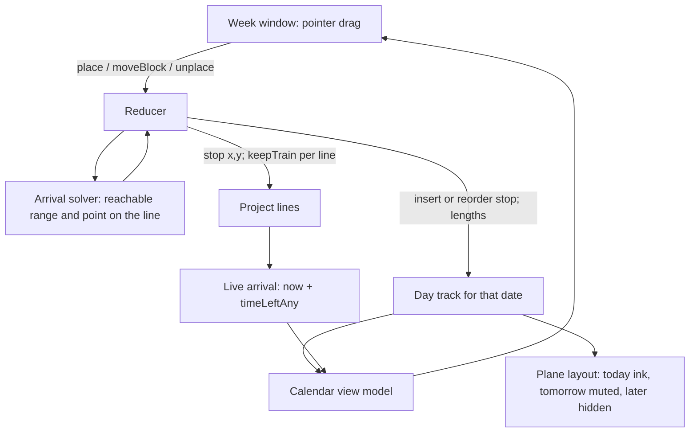
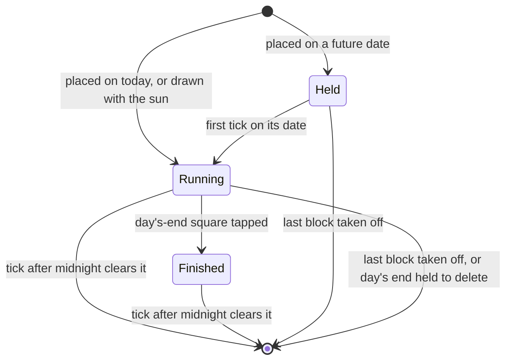
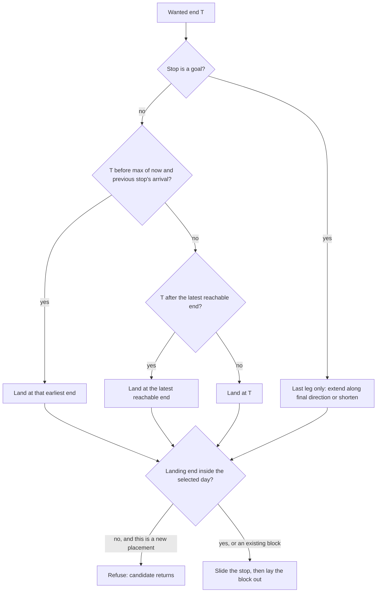

# Week Window - Plan

## Goal Capsule

- **Objective:** Ian can open a week over the map, put his lines' next stops into the hours of any day, and see the map bend so each train arrives when he planned to finish, so tomorrow is a set of hours rather than something up in the air.
- **Means:** each planned day is its own day line, and a block's end is its stop's live arrival time, set by sliding the stop along its line (KTD1, KTD3).
- **Authority:** the Product Contract's Key Decisions and Requirements win on behavior. KTDs win on mechanism. The Figma file `y95NHifalPMqa8DP960l4v` (screen 4:4, states 5:60, components 3:2) wins on look where it does not contradict a requirement. Earlier specs in `docs/superpowers/specs/` hold wherever this plan is silent.
- **Execution profile:** one pull request, built test-first in `src/model` and `src/plane`, units in the order listed.
- **Stop conditions:** stop if a change would let a saved world fail validation and open empty, or if a settled decision proves unbuildable. Report either rather than working around it.
- **Who finishes:** the executing agent builds, verifies in the browser, and opens the PR. Ian merges.

---

## Product Contract

### Summary

A week window opens over the plane from a round button above the plus. It shows a Monday-to-Sunday row of day buttons and one scrolling midnight-to-midnight day. Dragging a line's next stop onto an hour places it on that day's day line and slides the stop along its line so its train pulls in when the block ends. Tomorrow's day line shows on the map, muted and thin.

### Problem Frame

Ian has ADHD and is time-blind. His lines already say what matters and roughly how long each leg should take, but a leg's length is journey time, not working time, and nothing turns it into hours on a particular day. The day line drawn with the sun says "today, these, in this order" but has no clock. Without hours attached, the next day stays vague, and vague days are the ones where nothing starts. The window gives the lines a calendar face without adding a second idea of time: the hour a block ends is the moment the line's own train arrives.

### Requirements

**The window**

- R1. A round ink button above the plus opens and closes the window. Escape closes it. A tap on the plane outside it closes it.
- R2. The window has a row of seven day buttons for one calendar week, Monday to Sunday, labelled by day abbreviation, with arrows to the previous and next week. The week's name sits above the row: This week, Next week, Last week, In N weeks, N weeks ago.
- R3. Today's button has red text and a red bar beneath it. The selected day's button is filled ink. The window opens with tomorrow selected.
- R4. Below the row is one day plane: hours from 12 am at the top to 11:59 pm at the bottom, scrolling vertically. Horizontal position means nothing.
- R5. On today only, a red line crosses the day plane at the current time, and the plane scrolls to it when today is selected.
- R6. A Next stops column lists, for each line that is not parked, its first pending stop that is on no day line, soonest first, drawn as its shape in its line's colour with its name. A sketch line's goal is listed in muted bold capitals.

**Blocks**

- R7. A block is a stop on that day's day line, drawn in its line's colour with a one-size glyph of its shape and its name. It shows its start and end times when it is tall enough.
- R8. A block's end is the stop's live arrival time on the map. Its length is stored. Its start is the end minus the length.
- R9. Dragging a candidate onto the day plane places it. The finger sets the block's start, snapped to 15 minutes. The default length is 30 minutes for a small stop, 1 hour for medium and 2 hours for large.
- R10. Dragging a block moves it. Dragging its bottom edge stretches it, moving the end and keeping the start. Each sets the stop's arrival to the new end.
- R11. Dragging a block back onto the Next stops column takes it off its day. The stop stays where the block put it on the map.
- R12. Holding a dragged block or candidate over a day button for half a second selects that day, and the drag continues there.
- R13. A tap on a block does nothing. Completing a stop happens on the plane.
- R14. A done stop's block is muted with a dot glyph, ending at the time it was done, and is drawn only on the day that time falls in.
- R15. A block whose train is waiting at its stop rides the now line on today. Nothing is ever drawn as late.
- R16. A drag that asks for an unreachable end lands at the nearest reachable end. A drop with no reachable end on that day is refused and the candidate returns to the column.

**The map**

- R17. Each date has at most one day line. A stop sits on at most one day line.
- R18. Today's day line is drawn as now: ink, full width, its train shadowing the projects. Tomorrow's is drawn muted at half width, its train waiting at its start. Later days are not drawn on the map.
- R19. A day's train waits at its start until its day begins, then shadows as today's does.
- R20. Days run midnight to midnight. At midnight, yesterday's day line clears. Its unfinished stops come back to the Next stops column and nothing records that they were planned.
- R21. The sun brush and the day's-end drag keep working on today's day line. A stop they add gets the default length.
- R22. Placing a stop whose train is waiting at it sets that train rolling toward the block's end.

**Keeping the save safe**

- R23. A world saved before this change loads unchanged. A world saved by this change never fails validation on reload.
- R24. Each window gesture is one undo step. Undo never switches the selected day.

### Key Decisions

- **The layout is Ian's own: a week row over one scrolling day plane.** (session-settled: user-directed — chosen over two side-by-side columns for today and tomorrow: Ian replaced the proposal with his own layout.) Governs R2, R3, R4.
- **The week row is the calendar week, Monday to Sunday, with arrows.** (session-settled: user-directed — chosen over the next seven days from today, and over Sunday to Saturday: Ian's choice.) Governs R2.
- **No fixed events in this build.** (session-settled: user-approved — chosen over plain ink blocks typed into an empty hour: use it a week first.) Governs the Scope Boundaries.
- **Tomorrow's day line is on the map, muted and thin.** (session-settled: user-approved — chosen over showing it in the window only: the plan belongs on the map.) Governs R18.
- **Placing a waiting stop sets its train rolling.** (session-settled: user-approved — chosen over leaving the train waiting: "tomorrow at ten" says it is not due now.) Governs R22.
- **A block's end is the stop's arrival, and moving it slides the stop along its line.** (session-settled: user-approved — chosen over the block's start being the arrival: the train pulls in as the work finishes.) Governs R8, R10.
- **Days run midnight to midnight everywhere.** (session-settled: user-approved — chosen over 4 am everywhere and over a mixed rule: one rule the window and the map agree on.) Governs R20.
- **Any of the seven days can be planned, each its own day line.** (session-settled: user-approved — chosen over planning only today and tomorrow: Ian's choice.) Governs R17, R18, R19.
- **Today is red.** Ian asked for it. It overrides the specs' anti-goal "nothing is red" for this one marker, which means today or now and never late. Governs R3, R5.

### Scope Boundaries

- Fixed events (meetings, lunch) are out, per the Key Decisions.
- Completing, renaming or deleting a stop from the window is out. The window plans; the plane does.
- No sync with Google Calendar or any other calendar.
- No history: past days hold nothing, and nothing counts what was planned or missed.
- Considered and not built: pinning a placed stop's arrival so blocks never move on their own. Pinning would make the map move stops by itself every tick and erase Ian's leg estimates. Revisit if Ian finds the live ripple confusing in use.
- Considered and not built: striping an interchange block in every line's colour. One colour, its governing line's, is enough until Ian asks.

#### Deferred to Follow-Up Work

- Updating the "Calls Claude made" lists in the older specs. This plan's design note supersedes the 4 am rule; the old specs stay as history.

### Assumptions

These are agent bets Ian has not confirmed. Each is cheap to change after he tries the window.

- A block's end can move only between the arrival of the stop before it on its line and the arrival of the stop after it, and never before now (KTD3).
- A goal's block moves only its last leg (KTD4).
- A stop on two project lines is one block, coloured and slid along the line whose train arrives first (KTD5).
- Day lines made from the window place their start a fixed gap above their first stop and their end square a fixed gap below their last (U4).
- On touch, a block drags after the finger rests on it for 200 ms; otherwise the touch scrolls the day.
- A block whose arrival drifts outside its day is drawn clipped at that day's top or bottom edge, not moved to another day (KTD2).

---

## Planning Contract

### Key Technical Decisions

- KTD1. **One stored day track per date.** The existing `Track.day` becomes plural: any number of day tracks, unique by `date`. Each keeps today's model of `budgets`, and gains `lengths`, one block length in seconds per stop, aligned with `stops` like `budgets`. A stop that joins a day by any path gets its concrete default length in seconds, never a placeholder. A day line made by `place` also carries `placed: true`; a sun-drawn line does not. Every single-day helper in `src/model/day.ts` and every reducer action that reaches "the" day takes a day id instead. Rationale: Ian chose "each planned day is its own day line" (R17), and this reuses the shadow-train code that already works. Deriving a day from each stop's arrival date was considered and rejected: it would need a second model of the day line beside the sun's.
- KTD2. **A block's day is its day line's date, not its arrival's date.** A block drifts with its arrival, but it stays on the day it was placed. Where the end leaves that day it is drawn clipped at the edge. Rationale: the alternative moves blocks between days on their own, which reads as the plan rewriting itself.
- KTD3. **Placing or moving a block is a slide along the governing line.** A pure solver takes a stop and a wanted arrival and returns the point on its line that gives it. Only the leg into the stop sets its arrival, so the solver finds the target length of that leg. When the train is on that leg, it solves the motion-profile inverse by bisection. It then walks the route from the previous stop to the next stop to find the point with that leg length. The result is clamped to the reachable range: earliest is `max(now, arrival of the previous stop)`; latest is the previous stop's arrival (or the start of the train's leg) plus the longest re-routed leg the walk reaches, which equals the next stop's arrival only when the stop lies on the route between its neighbours. It is applied through the same `move` path as a drag, with `keepTrain` per line. The solver then re-reads the stop's arrival; if another line through it now arrives first, it bisects the wanted end down to the latest end the governing line still delivers and reports the slide as clamped. Rationale: it keeps the settled "only the two legs beside it change" rule and the train-never-jumps invariant without a new kind of edit.
- KTD4. **A goal block changes only its last leg.** Later extends the last leg along its final direction. Earlier shortens it along the route. Rationale: a goal drag on the plane scales every stop ahead of the train, which would move every other block on the line.
- KTD5. **Interchange blocks follow the line whose train arrives first.** That is the line `timeLeftAny` already picks, so the arrival shown is the arrival solved for.
- KTD6. **Stops record when they were done.** `Stop.doneAt` is set by `complete` and cleared by `undo`. It is optional, so older worlds stay valid. It is used only to place a done block (R14).
- KTD7. **A future day's train is held at its start.** A day track whose `date` is after today reports its train waiting at its origin. The tick that first sees a held day as today starts it: `budgets[0]` becomes the project time left now, and it departs now. Rationale: R19, and a day must not start shadowing a week early.
- KTD8. **The tick clears only past days and starts today's.** It compares `YYYY-MM-DD` strings, clears every day before today, starts a held day that is now today, and returns the same world object when nothing changed, since the store skips listeners on an unchanged world. A timer also fires a tick at the next midnight, so a plane where every train is parked still turns over.
- KTD9. **Storage moves to `chronologic.v4` and reads v3 and v2.** The validator accepts several day tracks with unique dates, optional `lengths` and optional `doneAt`. Each day's end square must be on no other track. Older keys are read and never written. Rationale: an older build reading a several-day world would reject it and open empty, and the storage comment says to bump the key when the shape changes.
- KTD10. **The window mounts beside the plane, not inside its HUD.** The plane's non-passive wheel listener would otherwise zoom the map instead of scrolling the day. The window's root still carries `data-target="hud"` for the recognizer. Its open state lives in a ref as well, because the Escape listener is registered once and reads refs.
- KTD11. **The calendar's arithmetic is a pure module.** Week of a date, day bounds, the y-to-time mapping, 15-minute snapping, block layout, clipping and the candidate list live in one module tested without a browser, as the repo's model and plane modules are. The window component only renders and handles pointers.
- KTD12. **Time is laid out by wall clock.** There are always 24 rows, and a y maps to a time through the local date's hour and minute fields, so the `Date` constructor settles daylight-saving days. No special handling and no daylight-saving test: a wrong hour on two days a year is visible and cheap to fix later.

### High-Level Technical Design

How a block drag reaches the map and comes back as a block:

A day line's life:

Where a dragged end lands:

### Sequencing

Model first, so every later unit builds on the several-day world and the new save format: U1, then U2, then U3, then U4. The view model (U5) needs U4's data. The window (U6) needs U5, and its gestures (U7) need U6. The plane changes (U8) need only U1 and can land any time after it. U9 closes with docs.

---

## Implementation Units

### U1. Several day lines, midnight days, and the v4 save

**Goal:** the world can hold one day line per date, days turn over at midnight, and the new shape saves and loads safely.

**Requirements:** R17, R19, R20, R23. KTD1, KTD7, KTD8, KTD9.

**Dependencies:** none.

**Files:**
- `src/model/types.ts`, `src/model/day.ts`, `src/model/days.ts`, `src/model/reducer.ts`, `src/model/train.ts`
- `src/store/storage.ts`, `src/test/fixtures.ts`
- `src/ui/App.tsx` (callers of the changed actions: `dragDayEnd`, `holdEnd`, `dropSun`, the editor's leave chips)
- Tests: `src/model/days.test.ts`, `src/model/reducer.test.ts`, `src/store/storage.test.ts`, `src/ui/App.test.tsx`

**Approach:**
1. Set the day turnover to midnight in `days.ts`.
2. Make every helper in `day.ts` take a day track or day id: `dayTrack` becomes a lookup by date plus a list of days, `isDayEnd` checks every day's last stop, and `clearDay`, `settleDay`, `freshDayBudget` and `dayBackTo` act on one day or on each.
3. In the reducer, `withoutStop` keeps a fresh flag per day. `reduce` settles every running day; `settleDay` and `freshDayBudget` skip a held day (date after today). `delete` of an end square clears the day that owns it. `undo` puts back every day the stop is on. `addToDay`, `moveDayEnd` and `clearDay` carry a day id.
4. `newDay` replaces only the day with the same date. `newDay` and `addToDay` first take each picked stop off any other day line (R17). Every stop joining a day gets its concrete default length in seconds from the size table, which lives in `day.ts`: small 30 min, medium 1 h, large 2 h. No 0 placeholder is ever stored.
5. `dayState` reports a held day as waiting at its origin (KTD7). The tick clears past days and starts today's held day (KTD8): its train moves to the first pending stop, that leg's budget becomes the project time left now, and it departs now. App schedules a tick at the next midnight.
6. Storage: key `chronologic.v4`, read order v4, v3, v2. `isDay` accepts optional `lengths` aligned with stops. `tracksAgree` replaces "at most one day" with "dates unique, each day's end square on no other track".
7. App's sun still draws today. The editor's leave chip names a day by its weekday, not "today", when it is not today's.

**Execution note:** start with the storage tests that a two-day world round-trips and that deleting a second day's end square leaves a valid world. That failure mode opens the save empty.

**Patterns to follow:** `dayWithout` already works per track. `withDay()` in `src/test/fixtures.ts` is the fixture to extend into a `withWeek()`. The v2-to-v3 read in `storage.ts` `load` is the migration pattern.

**Test scenarios:**
- `dayOf` at 23:59 returns that date. At 00:00 it returns the next.
- A tick at 00:01 on Nov 7 clears a Nov 6 day line and keeps a Nov 7 and a Nov 9 line.
- A tick that changes nothing returns the same world object.
- A tick on Nov 7 starts a held Nov 7 line: its first budget becomes the project time left, and its train departs at the tick.
- The state of a Nov 9 day's train on Nov 7 is waiting at its origin.
- `newDay` for Nov 8 leaves an existing Nov 7 line untouched. `newDay` for Nov 7 replaces the old Nov 7 line.
- Deleting Nov 8's end square removes only Nov 8's line. The saved world reloads with Nov 7 intact.
- Completing a stop on Nov 7's line settles Nov 7's day train and leaves Nov 8's alone.
- `addToDay` with a day id appends to that day only.
- The sun drawing today through a stop on Nov 7's line removes it from Nov 7.
- A stop on Nov 9's line completed on Nov 7 leaves Nov 9 held; on Nov 9 its train starts at the first pending stop with a fresh budget.
- A v3 world with one day loads under v4 unchanged. A v2 world loads. Neither key is written.
- Validation rejects two days with the same date, a `lengths` array of the wrong length, and an end square listed on a project.
- The App test "drawing a new day replaces the old" still holds for today. A day drawn with the sun on Nov 6 leaves a Nov 7 line in place.

**Verification:** every existing test passes after the 4 am tests are rewritten to midnight, and the new storage and reducer tests pass.

### U2. Stops remember when they were done

**Goal:** a done stop carries the time it was completed, for drawing its block.

**Requirements:** R14. KTD6.

**Dependencies:** U1.

**Files:** `src/model/types.ts`, `src/model/reducer.ts`, `src/store/storage.ts`. Tests: `src/model/reducer.test.ts`, `src/store/storage.test.ts`.

**Approach:** `complete` sets `doneAt: now` on the stop it completes, including the goal and the day's-end square. `undo` removes it. `isStop` accepts an optional finite `doneAt`.

**Patterns to follow:** the optional `image` field on `Stop` and its validation.

**Test scenarios:**
- Completing a stop at time T sets its `doneAt` to T.
- Undoing it removes `doneAt`.
- A stop completed on one line and passed through on another has one `doneAt`.
- A world with `doneAt` round-trips through storage. A non-number `doneAt` is rejected.

**Verification:** the reducer and storage tests pass.

### U3. The arrival solver

**Goal:** given a stop and a wanted arrival, find the reachable range and the point on its line that gives that arrival.

**Requirements:** R8, R10, R16, R22. KTD3, KTD4, KTD5.

**Dependencies:** U1.

**Files:**
- Create `src/model/arrive.ts`
- Test: `src/model/arrive.test.ts`
- Reads from `src/model/train.ts` (`trainState`, `timeLeft`, `timeLeftAny`, `legSeconds`, `trackRoute`), `src/model/motion.ts` (`invertProgress`), and `src/plane/routing.ts` (`legSpan`, `pointAlong`, `cutAt`, `routeThrough`, `pathLength`)

**Approach:**
1. `arrivalOf(world, stopId, now)` is `now + timeLeftAny × 1000`. It is `now` for a stop whose train waits at it.
2. `governingLine` returns the project line whose train reaches the stop first (KTD5).
3. `reach(world, stopId, now)` returns the earliest and latest reachable ends on the governing line. Earliest is the larger of now and the previous stop's arrival. Latest is set by the longest re-routed leg the walk from the previous stop to the next reaches (KTD3), or no limit for a goal.
4. `slideTo(world, stopId, end, now)` clamps the end to the reach, finds the target length of the leg into the stop, solving by bisection when the train is on that leg, then finds the point along the route from the previous stop to the next whose re-routed leg has that length. It re-reads the arrival at that point and, if another line now arrives first, bisects the end down as KTD3 says. It returns the point, the end it lands at, and whether it was clamped.
5. For a goal, the point lies along the last leg's route when earlier and along its final direction when later (KTD4).

**Execution note:** implement test-first. The tolerance for "arrives at T" is one second.

**Technical design:** directional only. The leg into stop k has target length `L* = (T − now)/1000 − timeLeft(previous stop)` when the train is behind leg k. When the train is on leg k, with seconds covered `s`, solve `(1 − invertProgress(s/L))·L = (T − now)/1000` for `L ≥ s`. The left side increases with L, so bisection converges. Walk distance `d` along the route from the previous station to the next; the re-routed leg length equals `d` up to the stop's current position and need not increase past a bend, so take the first `d` that matches.

**Test scenarios:**
- A stop two legs ahead of a rolling train, slid to arrive one hour earlier, gets a point whose new routed leg gives that arrival within one second.
- A stop whose train is on its leg, slid later, arrives at T, and the train keeps the seconds it had covered on that leg.
- A stop whose train is waiting at it, slid to an hour from now, sets the train rolling and arrives in an hour (R22).
- A wanted end before the previous stop's arrival is clamped to that arrival and reported clamped.
- A wanted end before now is clamped to now.
- A wanted end after the next stop's arrival is clamped to that arrival.
- A stop on the straight route between its neighbours keeps the next stop's arrival unchanged after the slide.
- A stop dragged off the route earlier, slid past the bend, still arrives at T. The next stop's new arrival is reported.
- A goal slid later extends its last leg along its final direction, and no other stop moves.
- A goal slid earlier shortens its last leg along the route.
- An interchange stop slides along the line whose train arrives first, and the block's end equals the landing end reported.
- A stop bent off the route between its neighbours has a latest end before the next stop's arrival.

**Verification:** the solver's tests pass with no browser.

### U4. Block actions in the reducer

**Goal:** placing, moving, stretching and taking off a block are reducer actions that slide the stop and keep the day lines right.

**Requirements:** R8, R9, R10, R11, R16, R17, R21, R22, R24. KTD1, KTD2, KTD3, KTD7.

**Dependencies:** U1, U2, U3.

**Files:** `src/model/reducer.ts`, `src/model/day.ts`. Tests: `src/model/reducer.test.ts`.

**Approach:**
1. `place { stopId, date, end, length, now }` refuses a done stop, a day's-end square, a stop on no project, and a landing end outside `date`. It takes the stop off any other day line (R17), slides it per U3, then adds it to the day line for `date`, creating one if needed (held if the date is after today). The stop is inserted in arrival order, and its length written. On a day whose train has departed, stops before the train's leg keep their places and only stops at or after it are ordered by arrival; `budgets` and `lengths` move with their stops, an insertion before the leg raises it by one, and if the stop at the leg changes its budget is written fresh.
2. `moveBlock { stopId, end, length, now }` refuses a done stop. Otherwise it slides the stop, writes the length, and reorders the day's stops by arrival under the same rule as `place`. A clamped landing outside the day still moves the block; it is drawn clipped (KTD2).
3. `unplace { stopId, now }` takes the stop off its day line through the existing leg-merge path. The stop keeps its position (R11). A day line left with only its end square is removed.
4. A day line made by `place` puts its origin a fixed gap above its first stop and its end square a fixed gap below its last. Both are re-placed when the order changes and the day carries `placed: true` (Assumptions).
5. The default lengths come from U1's size table (R9).
6. Each action is one undo step through the store's existing recording.

**Patterns to follow:** `newDay` and `addToDay` for building a day track. `move` and `keepTrain` for applying a position. `dayWithout` for removal.

**Test scenarios:**
- Placing a pending stop on tomorrow at 10:00 to 11:00 creates tomorrow's held day line with that stop, its length 3600, and the stop's arrival at 11:00.
- Placing a second stop at 9:00 to 9:30 inserts it before the first.
- Placing a stop already on Thursday onto Friday removes it from Thursday. A Thursday line left empty is removed.
- Placing a stop whose train waits at it sets the train rolling, and its arrival is the block's end.
- Placing a stop where no end on that day is reachable returns the same world.
- Moving a block to 14:00 slides the stop. Its arrival becomes 14:00, and the day's order follows arrival.
- Stretching a block keeps its start and moves its end and arrival.
- Moving a done stop's block returns the same world.
- On today, moving the second block before the first keeps the day train consistent with its new target.
- Taking a block off leaves the stop's position and its project lines unchanged, and removes it from the day line.
- A place followed by undo restores the world exactly. Redo re-applies it.
- Placing on today creates a running day line whose train shadows at once.

**Verification:** the reducer tests pass, and a world built by these actions round-trips through storage.

### U5. The calendar view model

**Goal:** a pure module turns the world, a selected date and the clock into everything the window draws.

**Requirements:** R2, R3, R4, R5, R6, R7, R8, R14, R15. KTD2, KTD11, KTD12.

**Dependencies:** U4.

**Files:** create `src/plane/week.ts`. Test: `src/plane/week.test.ts`.

**Approach:**
1. Week arithmetic: the Monday of a date's week, the seven dates, a week offset's name ("This week", "Next week", "Last week", "In 3 weeks", "2 weeks ago"), and the weekday abbreviation.
2. Day geometry: 64 pixels per hour as one constant, y for a wall-clock time on a date, the time for a y, and snapping to 15 minutes (KTD12). The shortest block is 15 minutes. Times show on a block 40 px tall or more.
3. Blocks for a date: for each stop on that date's day line, its colour (from the governing line), glyph shape, name, done flag, end (arrival, or `doneAt` when done), start (end minus length), and clipping flags when it leaves the day. Done blocks whose `doneAt` falls outside the date are left out (R14). Overlapping blocks share the width in side-by-side lanes, as horizontal position means nothing (R4). A clipped block's label shows its true times.
4. Candidates: per non-parked project line, the first pending stop at or after the train's next stop that is on no day line, ordered by arrival, with a sketch flag.
5. The now line's y, present only when the date is today.

**Test scenarios:**
- The Monday of Thursday Nov 5 2026 is Nov 2. The week's dates run Nov 2 to Nov 8.
- A week offset of 1 is named "Next week", -1 "Last week", 3 "In 3 weeks".
- 9:30 maps to y equal to 9.5 hours of pixels. A y between 9:37 and 9:52 snaps to 9:45.
- A block ending at 11:00 with length 3600 starts at 10:00.
- Two overlapping blocks get two lanes; a block that overlaps nothing gets the full width.
- A block whose arrival drifted to 00:30 the next day is clipped at the bottom of its date.
- A done stop's block ends at its `doneAt` and is muted. It is absent from a date that `doneAt` does not fall in.
- A stop whose train waits at it on today ends at now.
- Candidates list one stop per line, skip stops already on a day, skip parked lines, and come soonest first. After the first stop is placed, the line's following stop is listed.
- The now line is present on today and absent on other dates.

**Verification:** the view-model tests pass with no browser.

### U6. The week window and its button

**Goal:** the window renders the Figma design and opens and closes from its button.

**Requirements:** R1, R2, R3, R4, R5, R6, R7, R13, R14, R15. KTD10.

**Dependencies:** U5.

**Files:**
- Create `src/ui/WeekWindow.tsx`, `src/ui/WeekButton.tsx`
- Modify `src/ui/App.tsx` (mount beside the plane, open state and its ref, Escape, outside tap) and `src/styles/ui.css`
- Tests: create `src/ui/WeekWindow.test.tsx`, extend `src/ui/App.test.tsx`

**Approach:**
1. The button sits above the plus and is written like `.hud-add`. Its glyph is the week glyph from the Figma file.
2. The window is paper with a 4 px ink frame and a 22 px radius, centred over the plane, per screen 4:4. Its header, week row, Next stops column and day plane follow the Figma components: Day button, Candidate, Block, Block glyph.
3. Colours come from the existing tokens, `--track-red` for today. Arimo in Figma stands in for the app's Helvetica stack, which the window uses.
4. The day plane scrolls with its own wheel and touch handling. Wheel events inside the window never reach the plane. On opening with today selected it scrolls to now; otherwise to the first block or 8 am.
5. While the window is open, Backspace does not delete the plane's box selection, and the brush is off.
6. A day before today shows its button text muted. A done block shows no stretch handle and does not drag.

**Patterns to follow:** `Tray.tsx` and `History.tsx` for HUD markup and `data-target="hud"`. The `.hud-add`, `.pill-text` and `.bubble` rules in `ui.css` for sizes and fills. The Figma components board 3:2 for layout.

**Test scenarios:**
- Clicking the button opens the window with tomorrow selected. Clicking it again closes it.
- Escape closes the window. A tap on the plane outside closes it.
- Today's button carries the today style. The selected button carries the selected style. Both apply when today is selected.
- The arrows step the week, and the week name changes to "Next week".
- With two lines, the column lists both next stops, soonest first.
- A placed block shows its name and its start and end times.
- A wheel event over the day plane scrolls it and leaves the camera unchanged.
- With no lines, the column and the day plane are empty, and no message is shown.

**Verification:** the component and App tests pass, and the window matches Figma screen 4:4 in a browser.

### U7. Window gestures

**Goal:** blocks are placed, moved, stretched and taken off by dragging, as one undo step each.

**Requirements:** R9, R10, R11, R12, R13, R16, R24.

**Dependencies:** U6.

**Files:** `src/ui/WeekWindow.tsx`, `src/ui/App.tsx`. Tests: `src/ui/WeekWindow.test.tsx`, `src/ui/App.test.tsx`.

**Approach:**
1. Pointer handling lives in the window. A drag from a candidate or a block shows a ghost block that follows the finger, snapped to 15 minutes, with its end clamped to the reach from U3. A ghost whose drop would be refused is drawn muted, so the refusal shows before release.
2. Release dispatches `place`, `moveBlock` or `unplace` inside `store.begin()` and `store.end()`, so one gesture is one step. A refused drop leaves the world unchanged, so nothing was recorded; the window calls `store.end()` and the ghost returns. `retract` is not called, since it would take back the previous, unrelated step.
3. The stretch handle is the bottom third of a block, at least 8 px and at most 16 px tall.
4. Hovering over a day button for 500 ms selects it, and the drag continues.
5. Touch waits 200 ms of rest before a drag. The day plane scrolls automatically within 48 px of its top and bottom edges.
6. A tap on a block does nothing.

**Patterns to follow:** App's `dragStart` and `dragEnd` with `store.begin()` and `store.end()`. The `dragStop` and `point` helpers in `App.test.tsx`.

**Test scenarios:**
- Dragging a candidate to the 10:00 row on tomorrow places it from 10:00 to its default end. Undo removes it in one step.
- Dragging a block from 10:00 to 14:00 moves it, and the stop's arrival on the map becomes its new end.
- Dragging a block's bottom edge from 11:00 to 11:30 stretches it, and the start stays 10:00.
- Dragging a block onto the Next stops column takes it off, and the stop stays where it was.
- Dragging below the next stop's arrival lands the block's end at that arrival.
- A candidate whose earliest end is after the selected day's end is refused and returns. No undo step remains, and the step before it is still there to undo.
- Holding a dragged block over Saturday's button switches the day plane to Saturday, and releasing places it there.
- A tap on a block changes nothing.

**Verification:** the gesture tests pass, and a real drag in the browser places, moves and takes off a block.

### U8. The plane shows today and tomorrow

**Goal:** the map draws today's day line as now, tomorrow's muted and thin, and hides later days everywhere.

**Requirements:** R18, R19, R21.

**Dependencies:** U1.

**Files:** `src/plane/layout.ts`, `src/ui/Track.tsx`, `src/ui/stopsOnce.ts`, `src/ui/Bubble.tsx`, `src/plane/opening.ts`, `src/plane/select.ts`, `src/ui/App.tsx`. Tests: `src/plane/layout.test.ts`, `src/plane/select.test.ts`, `src/ui/App.test.tsx`.

**Approach:**
1. `layoutTrack` takes today's date and marks a day view as `tomorrow` or hidden. App leaves out hidden days' views, so they get no bubble, no stop buttons and no ring.
2. `Track.tsx` draws a `tomorrow` view like a sketch: muted, half width.
3. The opening camera opens on today's day only.
4. Box select ignores the origins of hidden day lines.
5. A stop's ring counts only the lines that are drawn.

**Patterns to follow:** the sketch flag through `layout.ts`, `Track.tsx` and `stopsOnce.ts`, and its App test "a line with only its goal is a sketch at half width in the muted ink".

**Test scenarios:**
- With day lines for today, tomorrow and Sunday, the plane draws today in ink at full width and tomorrow muted at half width, and draws no Sunday line.
- Tomorrow's train sits at its start.
- A stop on a project and on Sunday's line is not drawn as a ring.
- The app opens on today's day train, not tomorrow's.
- A box drawn over a hidden day line's start does not pick it.

**Verification:** the layout, select and App tests pass, and a browser shows tomorrow's muted line.

### U9. Docs

**Goal:** the README and a design note describe the window and the midnight rule.

**Requirements:** R20 (the README's 4 am line).

**Dependencies:** U1 through U8.

**Files:** `README.md`, create `docs/superpowers/specs/2026-11-06-week-window-design.md`.

**Approach:** add the window's gestures to "Using it". Replace "The day clears itself at 4 am" with midnight. Name the `chronologic.v4` key. The design note records the Key Decisions, KTD1 to KTD12 in one line each, and the Assumptions for Ian to check, in the style of the earlier specs' "Calls Claude made".

**Test expectation:** none -- documentation only.

**Verification:** the README describes every gesture the window has, and no line still says 4 am.

---

## Verification Contract

| Gate | Command or method | Applies to |
|---|---|---|
| Unit and component tests | `npm test` | Every unit |
| Typecheck and production build | `npm run build` | Every unit, before the PR |
| Browser check | `npm run dev`, then open the window, place, move, stretch and take off a block, step a week, and see tomorrow's muted line | U6, U7, U8 |
| Save safety | reload after creating two day lines and deleting one's end square; the world must not open empty | U1 |

When running `npm test` from the main checkout, no `.worktrees/*` copies may be present, or vitest picks up their tests and fails on a second React.

## Definition of Done

- Every requirement R1 to R24 is met and covered by a test or by the browser check.
- `npm test` and `npm run build` pass.
- A world saved by v3 loads, and a world saved by this build reloads without opening empty.
- The window matches Figma screen 4:4 and states board 5:60 in a browser.
- No dead code from abandoned approaches is left in the diff.
- The README and the design note are updated.

---

## Sources & Research

- `docs/superpowers/specs/2026-11-01-day-line-design.md`: the day line, the shadow rule, budgets and settling.
- `docs/superpowers/specs/2026-10-31-tracks-design.md`: train motion, `keepTrain`, and the never-jump invariant.
- `src/model/reducer.ts` `keepTrain` and `src/model/train.ts` `rebase`: a waiting train whose leg lengthens already rolls again (R22).
- `src/plane/routing.ts` `pointAlong` and `cutAt`: a point at a path distance across several legs, reused by U3.
- `src/store/storage.ts`: the key-bump comment and the v2-to-v3 read pattern (KTD9).
- `src/ui/Plane.tsx` wheel listener: the reason for KTD10.
- Figma file `y95NHifalPMqa8DP960l4v`: screen 4:4, states board 5:60, components board 3:2.
