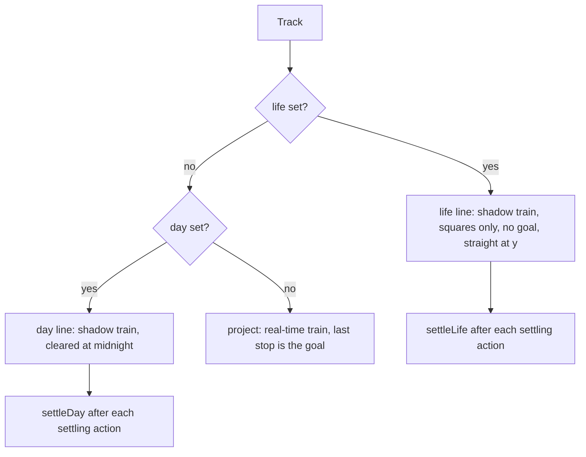
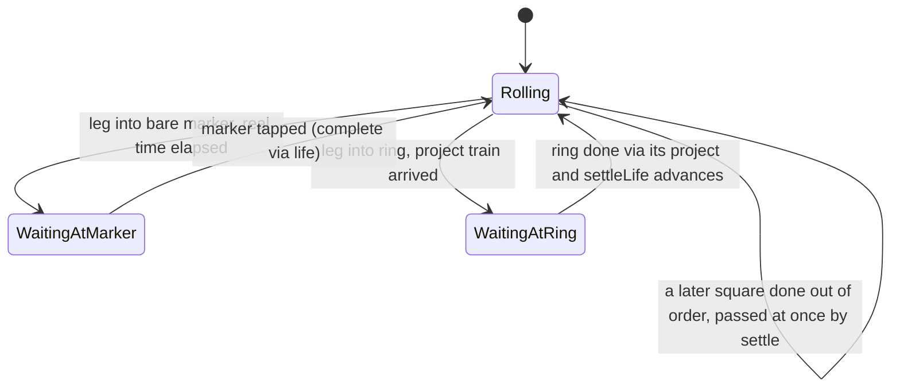

# Life Line - Plan

## Goal Capsule

- **Objective:** Opening Chronologic shows Ian the next stop, the project line it is on running to its goal, and that goal sitting on one line that runs on to a broad life goal such as "live in NYC with my girlfriend", so the reason for the step is drawn rather than remembered.
- **Means:** one permanent horizontal ink track per world, the life line, built on the day line's shadow-train machinery, with project goals joined to it as rings and bare squares on it as markers (KTD2, KTD4).
- **Authority:** the Product Contract's Key Decisions and Requirements win on behavior. KTDs win on mechanism. The origin design doc `docs/brainstorms/2026-11-06-life-line-design.md` holds where this plan is silent, except where a KTD below names and resolves a contradiction in it. Earlier specs under `docs/superpowers/specs/` hold for everything the plan does not touch.
- **Execution profile:** one pull request from `main`, built test-first in `src/model`, `src/store` and `src/plane`, units in the order listed, drawing last (KTD14).
- **Stop conditions:** stop if Ian's own saved world fails validation or does not open with its lines intact (a refused world in a test opens empty by design, AE6), if a settled decision proves unbuildable, or if PR #1 (Vignelli) merges mid-build and `src/plane/metro.ts` lane logic cannot keep the life line out of its lanes without a design change. Report rather than work around.
- **Who finishes:** the executing agent builds, verifies in the browser, and opens the PR. Ian merges.

---

## Product Contract

### Summary

A permanent life line is added to every world: a straight horizontal ink track whose train is a shadow of the project trains, whose stops are squares only, and which runs off both edges of the paper. A project's goal dropped on it becomes a ring on both lines. A square on it alone is a marker, a broad life goal. Done squares on it stay drawn as small ink squares with their names. The app opens on the project train heading for the first undone ring, after today's day train. The grid and zoom reach years, and project lines hide at wide zoom so the far view is the life line and its cities. The saved world moves to a new storage key and gains an empty life line on first load.

### Problem Frame

Ian has ADHD. Short working memory and weak executive function mean he loses the thread between the step in front of him and the end it serves, and when the thread goes so does the will to do the step. He then drifts to things that pay at once. The project lines draw a step and its goal on one line, which is the v2 answer to "why this step". Nothing draws what the goal is for. He asked for an overarching track containing his whole life, broken into clusters that read as periods or cities, with broad markers on it, so that what he does this week is visibly on the way to those markers.

The app already has this shape at the scale of one day. The day line is an ink line through chosen stops whose train reaches each stop exactly when that stop's own project train does. The life line is the same shape at the scale of a life, so most of its mechanism exists and the work is mainly teaching roughly forty call sites that there is now a third kind of track.

### Key Decisions

- **The life line is Ian's idea, chosen over a flagged "trunk" project line.** A trunk would have made one project the main mission. The life line makes the main mission whichever project's goal is the next ring, with no flag to set. (session-settled: user-directed — chosen over a trunk flag on one project: he wants his whole life on one track, not one project promoted.) Governs R1, R2, R19.
- **Shadow train, not a real-time train.** The life train reaches a ring when that project's train does, and rides real time only into a bare marker. (session-settled: user-approved — chosen over a second real-time clock: it adds no second idea of time and waits where his life is actually waiting.) Governs R5, R6.
- **Straight and horizontal, never routed.** The only straight line on the map. (session-settled: user-approved — chosen over the 45-degree routing: the life line is an axis, and bends would make the past and future read as geography.) Governs R3, R4.
- **Markers are squares, not a new shape.** Solid square: a goal nothing feeds yet. Ring: a goal a project is working toward. (session-settled: user-approved — chosen over a fourth shape: the ring-or-solid contrast already says what matters.) Governs R7, R8.
- **Done squares on the life line stay as landmarks.** Small ink squares with names, the terminus style, never dots. (session-settled: user-approved — chosen over the dot every other done stop becomes: the left half of the line is the trophy room, with no count.) Governs R12.
- **Open on the next ring's project train.** After today's day train. The soonest train is the fallback. (session-settled: user-approved — chosen over opening on the soonest train: soonest is pressure, the next ring is direction.) Governs R19.
- **Zoom reaches five years.** The grid ladder gains a quarter, a year and five years, with levels where only the life line and its squares draw. (session-settled: user-approved — chosen over keeping the ladder at thirty days: markers years out must be reachable.) Governs R20, R21, R22.
- **Exactly one life line, never deleted, present from first load.** (session-settled: user-approved — chosen over an opt-in life line: an absent life line would need a creation gesture and a special empty state.) Governs R1, R24.
- **Out-of-order completion needs no new rule.** A ring further along can complete while the life train waits at an earlier square; the day line's existing rule carries. (session-settled: user-approved — chosen over blocking later rings: projects finish in their own order.) Governs R11.

### Requirements

**The track**

- R1. Every world holds exactly one life line, a track with `life` set, which no action deletes.
- R2. The life line is drawn in ink, wider than a project line, from the left edge of the viewport to the right edge at its own height, whatever its stops, and the ink left of its train is muted.
- R3. The life line's stops lie on one horizontal line at its height, ordered by x; the track never bends and its origin handle is not drawn or draggable.
- R4. Every stop on the life line is a square. A circle or triangle offered to it is refused, with the ghost shown muted.

**The train**

- R5. On a leg into a ring, the life train's position is the share of that leg's budget that the project's time left has run down, exactly as the day train's.
- R6. On a leg into a bare marker, the life train rides real time along the leg with the project trains' motion profile and waits at the marker.
- R7. A square on the life line and on no project line is a marker. A square on the life line and on a project line is that project's goal, drawn as a ring.
- R8. A square tile in the tray makes a marker when dropped on the life line to the right of the life train; dropped anywhere else it does nothing and its ghost is muted.

**Joining, leaving, completing**

- R9. A project's goal released on the life line, to the right of the life train, joins it: the goal's height becomes the life line's, and it is sorted into the life line's stops by x.
- R10. Dragging a ring moves it along the life line only. Its height stays pinned, the project's last leg bends to follow, and the life line's two legs beside it change. Nothing else moves and no other stop scales.
- R11. A tap on a ring completes it for its project under the project's own next-stop rule, never through the life line. A tap on a bare marker completes it when it is the life line's next undone square, whether or not the life train has arrived.
- R12. A done square on the life line is drawn as a small ink square with its name, and its name is always kept when labels are thinned.
- R13. The editor shows the life line's chip on a ring even when the ring is the rightmost square, and tapping it takes the goal off the life line and leaves nothing behind.
- R14. Deleting a project whose goal is a ring keeps that square on the life line as a marker, with its name, picture, size and done flag.
- R15. Deleting a bare marker removes only that square. The life line itself is never a deletion target, and its rightmost square is never treated as a goal.
- R16. Not done on a life square follows the day line's rule: the life line never blocks it, a ring's project rule governs the ring, and after a bare marker is un-done the life train heads for it again from where it stood.

**What never touches it**

- R17. Crowds never gather on the life line, the sun never picks up its squares, the split gesture never lands on it, and the week window never lists its squares nor slides them.
- R18. Box select may carry life squares, but moves them along the life line only, keeps their order by x, and never carries the life line's origin.

**Camera, zoom, levels**

- R19. With no day train for today, the app opens on the project train heading for the first undone ring on the life line. With no ring, on the life train framing its leg to the next marker if one exists. Otherwise the soonest project train, otherwise home.
- R20. The grid ladder gains 3 months, 1 year and 5 years, and the leg chip reads months and years for legs that long.
- R21. At the 3-month unit and wider, only the life line and its squares are drawn; project lines, their stops, trains and bubbles are hidden. At the 1-year unit and wider, rings are hidden too and only bare markers and done squares remain.
- R22. The camera zooms out far enough that the 5-year unit is reached on a landscape phone.
- R23. The life line has an edge bubble in ink pointing at its next undone square, filled when its train waits there. A tap cycles its target between next and the last square; a picture bubble flies to the marker.

**Storage**

- R24. Worlds save under `chronologic.v5`. Loading reads v5, then v4, v3 and v2, and a world without a life line gets an empty one placed below its stops.
- R25. A saved world that fails validation is kept under a sibling key rather than overwritten by the empty world's next save.

### Success Criteria

- Opening the app on a world with a joined project shows the next stop, its line to the ring, and the life line through the ring, in one view with no gesture.
- Every existing test that pins a project-line rule still passes without the fixtures gaining a life line.
- Ian's current saved world loads with its lines intact and a life line below them.

### Scope Boundaries

- No why sentence, first move, checkpoint triangles, far-out map keeping finished lines and checkpoints in ink, branch lines, siding, crowd restriction to a main line, or cab view. Those are the eight parked proposals in the origin doc.
- No marker default distance. A marker lands where it is dropped (KTD9).
- No gesture that drags a ring off the life line. Leaving is by the editor chip, the existing interchange rule (KTD4).
- No change to day lines, the week window's behavior, brushes, undo, or the box beyond the exclusions in R17 and R18.
- **Considered and not built:** carrying the life train's wait time into a crowd or any count. Nothing on the life line reads as late. Evidence that would change this: none; it is an anti-goal of the product.

#### Deferred to Follow-Up Work

- The New line brush released on the life line making a project whose goal starts as a ring (origin LL12, second sentence). The same result takes one more gesture today: draw the line, then drag its goal onto the life line.
- Excluding `.worktrees/**` from vitest in `vite.config.ts`, which the week-window plan noted as a trap when nested worktrees exist.

### Acceptance Examples

- AE1. **Covers R9, R10.** Given a project with steps and a goal, when the goal is released on the life line right of the life train, then the goal is a ring at the life line's height, the life line lists it between the squares its x falls between, and dragging the ring left or right changes only the project's last leg and the life legs beside it.
- AE2. **Covers R5, R11.** Given life line `[M1 bare, R2 ring of P, M3 bare]` with the life train waiting at M1, when P's train reaches its goal and Ian taps the ring, then R2 is done, P parks, the life train stays at M1, and after Ian taps M1 the life train passes R2 at once and rolls toward M3 in real time.
- AE3. **Covers R14.** Given a ring, when its project is deleted by the editor's held Delete, then the square remains on the life line as a solid marker with the same name and picture.
- AE4. **Covers R15.** Given the rightmost square on the life line is a bare marker, when Ian long-presses it, then the editor offers Delete for that stop only, and deleting it leaves the life line with its other squares.
- AE5. **Covers R21, R22.** Given a landscape phone viewport, when Ian zooms all the way out, then the legend reads "5 years", no project line is drawn, and rings are not drawn while bare markers and done squares are.
- AE6. **Covers R24, R25.** Given a v4 world of two project lines, when the app loads, then the world has those lines plus an empty life line below them, and the next save writes v5. Given a v5 world that fails validation, when the app loads, then the raw text is kept under `chronologic.v5.refused` and the app opens empty.

---

## Planning Contract

### Key Technical Decisions

- KTD1. **A third kind of track, named once.** `isProject(track)` is `!track.day && !track.life`, and `isShadow(track)` is `track.day || track.life`, both in `src/model/day.ts` beside `drawnOnPlane`. Every `!t.day` test in `src` that means "a project" is swept to `isProject`. Rationale: the repository research found about twenty-five such sites, and each untreated one silently treats the life line as a project, from `timeLeftAny` reading the life train's own clock to `delete` removing the whole life line when its last marker is deleted.
- KTD2. **`Track.life` mirrors `DayPlan`.** `life: { y: number; budgets: number[] }`, budgets alongside `stops` as the day's are. `stateOf` dispatches to a `lifeState` that uses the day fraction on a leg whose stop some project lists, and the project motion profile with the leg's x-length as seconds on a leg into a bare marker. A `settleLife` runs after every settling action beside `settleDay` and writes the next leg's budget. The life train is never rebased by `keepTrain`; instead `keepLife(before, after, now)` in `life.ts` runs after every action that changes the life stops: it finds the train's target again by stop id after a re-sort and carries that leg's budget with it, and when a parked or waiting life train gains a new leg (a square added or joined past it) it sets `departedAt` to now so the real-time leg does not count from a months-old arrival. The life line keeps its own budget helpers in `life.ts` (remove a square, fresh budget, depart) and is never routed through the day helpers in `day.ts`, which read and write `track.day`. (session-settled: user-approved — see Key Decisions, shadow train.) Governs R5, R6, R16.
- KTD3. **The "last stop is the goal" invariant gets one exception: the life line has no goal.** `homeOf` in `src/ui/App.tsx`, `delete`, `move`, `leave`, `join`, `addStop` and `undoable` in `src/model/reducer.ts`, and `isTrack` and `tracksAgree` in `src/store/storage.ts` all treat the life track by `isProject` rather than by position. A square's home is the project it is last on; a square on no project is a marker and valid only on the life line. The life line may be empty. Rationale: without this an empty life line, a mid-line marker, and a ring that is last on the life line all fail validation and the world opens empty.
- KTD4. **Rings join by release, move along the line, and leave by the chip.** `joinOnRelease` in `App.tsx` no longer returns early for a goal when the only hit is the life line. Because a goal drag dispatches `moveGoal` on every pointer move, which scales every pending stop ahead of the train, the join puts the project's pending stops back at their pre-drag positions (kept in `GoalDragStart.ahead`) in the same undo step, so only the goal moves and the last leg bends. A drag of any pending square on the life line, ring or bare marker, dispatches `move` with y pinned to `life.y` (a new `moveOnLife` action or a flag on `move`), which bends a ring's project's last leg and re-sorts the life stops by x. A `move` or `moveGroup` that would put a pending life square at or left of the life train, or left of the last done square, returns the same world, so the drag stops at that bound. `moveGoal`'s scaling applies only to a goal that is not on the life line. Leaving is the editor chip, shown for the life line regardless of index. Rationale: the origin doc's "drag it off" was a gloss; the interchange rule the README states is the chip, and a pinned-y drag has no clean way to leave. Resolves the origin's LL5-versus-Edges contradiction: `leave` leaves nothing behind, `delete` of the project keeps a marker (R13, R14).
- KTD5. **A ring's button speaks for its project.** `stopsOnce` in `src/ui/stopsOnce.ts` never lets the life track's listing own a square that a project lists; only a bare marker completes through the life track. Rationale: otherwise the life line's next index can be a ring while the project has pending steps, and a tap completes the goal early. A bare marker completes on a tap whether or not the train has arrived, which is the README's standing tap rule; the origin's "must be waiting" is dropped. Governs R11.
- KTD6. **Storage v5 with an ensure-life step in `load` only.** `load` reads v5, v4, v3, v2, validates with the life exceptions (the validator accepts a world with no life track and refuses one with two, so older worlds pass before they have one), then passes every value it returns through `ensureLife`: the validated world, and the empty world it returns when nothing is saved or the save is refused. The app therefore never runs on, or saves, a lifeless world; without this a refused load would run on the lifeless empty world, save it under v5, be refused again on the next load, and lose everything made since. `load` takes `now` and a storage with `setItem`, because a refused raw world is written once to `chronologic.v5.refused` and never overwritten there. An empty life line is prepended to `tracks` so it draws under everything. `EMPTY` stays lifeless for the reducer and App tests; a `withLife()` fixture joins `src/test/fixtures.ts`. Rationale: `history()` re-dispatches `tick` after undo, so an ensure step in a reducer action would re-run; and the App tests find tracks by DOM index. Governs R24, R25.
- KTD7. **Migration placement.** For an existing world the life line's y is the largest stop y plus one day of world units, so it sits below everything at the opening zoom, and its origin x is the smallest stop x. A fresh world's life line runs through the origin. `newTrack` colours by the count of project tracks so prepending the life line does not shift every new line's colour.
- KTD8. **Grid, camera and levels.** `UNITS` in `src/plane/grid.ts` gains 90 days ("3 months"), 365 days ("1 year") and 5 years. `MIN_SCALE` in `src/plane/camera.ts` becomes 5e-7, at which the 5-year unit is reached on a landscape phone and one screen holds about 50 years. `formatSeconds` gains month and year parts. The by-line rule lives in `layoutTrack` in `src/plane/layout.ts`, not in `showsAt`: a project view returns nothing at or above the 90-day unit, overriding the always-keep of next and goal, and its bubble goes with it; on the life line, rings are dropped at or above the 1-year unit. Rationale: the research showed the 5-year rung appears only below a scale of about 6e-7, so the origin's "five years across a phone" was not reachable at its stated zoom. Governs R20, R21, R22.
- KTD9. **No default marker distance.** A marker lands at the x where the tile is released, which must be right of the life train; its leg is that distance in seconds. Rationale: the origin's 90-day default would land the first marker about 78,000 px off screen at the opening zoom.
- KTD10. **The square tile.** `'square'` joins the tile type in `src/plane/gestures.ts`, the tray in `src/ui/Tray.tsx` as "Marker", `Ghost.tsx`, `Plane.tsx`'s tile parse, and `addStop`'s shape, which accepts a square only on the life track. A life-specific snap in `src/plane/snap.ts` offers the life line to squares only, anywhere right of the life train including past the last square, with the hit's y set to `life.y`; `snapToAll` never offers the life line to circles or triangles.
- KTD11. **Opening order.** `openingCamera` in `src/plane/opening.ts` tries today's day train, then the project that is last on the first undone ring in life order, then the life train framing its leg to the next bare marker, then `soonestTrack`, then home. Project framing, in `frame()` here and in tap-to-fit on a project line, never zooms wider than the scale at which the 30-day unit still draws (`GRID_MIN_PX / (30 * DAY)`, about 7.7e-6): with `MIN_SCALE` lowered to 5e-7, fitting a leg longer than about 14 months would otherwise land at the 3-month unit, where KTD8 draws no project at all, and the app would open on nothing. Governs R19.
- KTD12. **Exclusions.** `candidates`, `colorOf`, `governingLine`, `blockable`, the sun's candidates, the split's landing lines, `crowdAt`, `soonestTrack` and `startGroupDrag`'s keep all use `isProject`. Filtering by track kind is not enough for rings, which a project lists: a stop-level `onLife(world, stopId)` excludes any square the life line lists from the sun's candidates, `newDay` and `addToDay`, `blockable`, the week window's candidates and `slideTo`, so no life square is ever listed in the week window or slid off `life.y`. `moveGroup` clamps life squares to `life.y`, keeps them right of the life train, and re-sorts life stops by x; `pick` drops the life origin. Governs R17, R18.
- KTD13. **Drawing.** `TrackView` gains a `life` flag; `Track.tsx` draws it in ink at 1.5 times `TRACK_WIDTH`, extends the first and last segments to the clip bounds, draws no origin handle, and never marks it `finished` or `sketch`. `Stop.tsx` renders a done life square with a `landmark` class that reproduces the terminus look (a small ink square with its name) under its own CSS rule, distinct from the existing `terminus` rule so `App.test.tsx`'s pinned CSS order stays true. `labelsWithRoom` always keeps landmark names. `Bubble.tsx` takes `life` for ink and the filled state when the life train waits at its target. The life bubble targets the next undone square the current level draws: at the 1-year unit and wider, where rings are hidden, that is the next undone bare marker, else the last square, and a fly from the bubble lands no wider than the 1-year unit so its target is drawn; a picture bubble on the life line flies to the marker rather than fitting the line. Governs R2, R3, R12, R23.
- KTD14. **Base and sequence.** Branch from `main` at `3c9d442`. PR #3 (`build/week-slide-reach`, `App.tsx` and `arrive.ts`) and PR #1 (`build/vignelli`, routing and drawing) are open. Model, storage and plane units go first; U7 drawing goes last so a rebase onto Vignelli touches one unit. Under Vignelli the life line must be kept out of `lanesOf` in `src/plane/metro.ts`.

### High-Level Technical Design

The life line is a third track kind beside project and day. Which code path a track takes is decided by `isProject` and `isShadow` once, and every rule reads those.

How the life train moves on each leg:

### Assumptions

These are the planner's bets, made without a user in the loop. Each is cheap to change after a week of use.

- A bare marker completes on a tap whether or not the life train has arrived (KTD5), following the README's tap rule over the origin's "must be waiting".
- No life square is offered to the week window (R17, KTD12), so a goal on the life line cannot be planned into hours. If Ian wants to time-block finishing a project, the slide must learn to keep y.
- A ring's drag is always along the life line (KTD4). Leaving is by chip.
- A marker lands where dropped with no default distance (KTD9).
- `MIN_SCALE` of 5e-7 (KTD8), roughly 50 years across a landscape phone.
- Markers cannot be picked up by the sun or joined to a day line.
- The life line's bubble cycles between next and last; there is no sub-goal target on it.

---

## Implementation Units

### U1. Track kinds and the sweep

- **Goal:** the code knows three kinds of track, and no rule treats the life line as a project.
- **Requirements:** R1, R17, R18 (groundwork). KTD1, KTD12.
- **Dependencies:** none.
- **Files:** `src/model/types.ts`, `src/model/day.ts`, `src/model/day.test.ts`, `src/model/train.ts`, `src/model/relocate.ts`, `src/model/crowd.ts`, `src/model/arrive.ts`, `src/model/blocks.ts`, `src/model/reducer.ts`, `src/plane/layout.ts`, `src/plane/opening.ts`, `src/plane/snap.ts`, `src/plane/soonest.ts`, `src/plane/week.ts`, `src/plane/select.ts`, `src/store/storage.ts`, `src/ui/App.tsx`, `src/ui/Track.tsx`, `src/ui/stopsOnce.ts`, `src/test/fixtures.ts`.
- **Approach:**
  1. Add the `LifePlan` type and `Track.life` to `types.ts`.
  2. Add `isProject` and `isShadow` to `day.ts`, with tests.
  3. Replace every `!t.day` / `track.day` test that means "a project" with `isProject`, and every "a day" test that should also mean "the life line" with `isShadow`, using the table in the repository research (section 1.4) as the checklist; if that machine-local dossier is gone, `grep -rn "\.day" src --include=*.ts --include=*.tsx` is the checklist, and every hit is either swept or left with a reason.
  4. Add a `withLife()` fixture that returns `running()` plus a life line with two bare markers and one ring, and keep `EMPTY` lifeless.
- **Execution note:** no behavior change in this unit. The existing suite is the guard; run it after the sweep before anything else.
- **Patterns to follow:** `drawnOnPlane` and `days` in `src/model/day.ts`.
- **Test scenarios:**
  - `isProject` is false for a day track, false for a life track, true for a plain track.
  - `isShadow` is true for day and life tracks and false for a plain track.
  - `withLife()` builds, and its ring is listed by one project and the life line.
  - The whole existing suite passes unchanged.
- **Verification:** `npm test` green with no fixture gaining a life line.

### U2. The life line in the model

- **Goal:** the reducer and train model carry a life line correctly through join, move, leave, delete, complete, not-done and settle.
- **Requirements:** R1, R3, R4, R5, R6, R7, R9, R10, R11, R13, R14, R15, R16. KTD2, KTD3, KTD4, KTD5, KTD7.
- **Dependencies:** U1.
- **Files:** `src/model/life.ts` (new), `src/model/life.test.ts` (new), `src/model/train.ts`, `src/model/train.test.ts`, `src/model/reducer.ts`, `src/model/reducer.test.ts`, `src/model/relocate.ts`, `src/ui/stopsOnce.ts`, `src/ui/stopsOnce.test.ts` if one exists, otherwise cover through `App.test.tsx` in U6.
- **Approach:**
  1. `life.ts`: `lifeOf(world)`, `onLife(world, stopId)`, `lifeRoute` (a straight polyline through origin and stops at `life.y`), `settleLife` mirroring `settleDay`, `keepLife` per KTD2 (re-find the train's target by id after a re-sort, carry its budget, depart now when a parked or waiting train gains a leg), `sortedByX`, and the life line's own budget helpers (remove a square, fresh budget, depart), so no life track ever goes through the `track.day` helpers in `day.ts`.
  2. `train.ts`: `lifeState` per KTD2; `stateOf` dispatches on `life`; `timeLeftAny` skips shadows (already by U1).
  3. `reducer.ts`: `join` onto the life line accepts squares only, sets y, sorts by x, inserts a budget; `leave` from the life line allowed at any index and leaves nothing; `delete` of a project keeps its goal on the life line as a marker; `delete` of a bare marker removes the square only; `move` accepts a square that is on the life line, pins y and re-sorts, and returns the same world when the square would land at or left of the life train or left of the last done square; `moveGoal` refuses a goal on the life line; `addStop` accepts `'square'` on the life track only and refuses circles and triangles there; `complete` through the life track only for a bare marker; `undo` (Not done) treats life like day; `newTrack` colours by project count.
  4. `stopsOnce.ts`: a square listed by a project never speaks for the life track.
- **Execution note:** test-first in `reducer.test.ts` and `life.test.ts`, one `describe` per action as the file already does.
- **Patterns to follow:** `newDay`, `addToDay`, `withoutStop` and `dayWithout` in `reducer.ts` and `day.ts`; `dayState` in `train.ts`.
- **Test scenarios:**
  - Covers AE1. Joining a goal right of the life train sets its y to `life.y`, inserts it by x between existing squares, and leaves the project's other stops untouched.
  - Joining a goal left of the life train is refused and returns the same world.
  - Joining a circle or triangle to the life line is refused.
  - `move` of a ring to a new x keeps `life.y`, re-sorts the life stops, and changes only the project's last leg length.
  - `move` of a ring or marker past a neighbouring square re-sorts, and the life train still targets the same square by id with the same budget.
  - `move` of a pending life square to an x at or left of the life train, or left of the last done square, returns the same world.
  - `addStop` of a marker past a parked life train gives the train a leg departing now, not from its last arrival.
  - `moveGoal` on a ring returns the same world.
  - Covers AE2. With `[M1, R2, M3]` and the life train waiting at M1, completing R2 via its project leaves the life train at M1; completing M1 via the life track then advances past R2 and sets the leg into M3 with a real-time departure.
  - Completing a ring through the life track is refused even when it is the life line's next.
  - Completing a bare marker that is next succeeds before the life train arrives.
  - Completing a bare marker that is not next is refused.
  - Covers AE3. Deleting a project whose goal is a ring leaves the square on the life line with its title, image, size and done flag.
  - Covers AE4. Deleting the rightmost bare marker removes that square and keeps the life line and its other squares.
  - `leave` of a ring from the life line removes it from the life track only, at any index.
  - Not done on a bare marker sets the life train's leg to that square with a fresh departure.
  - `lifeState` on a leg into a ring returns the day fraction; on a leg into a bare marker it advances with real time and waits at the end.
  - An empty life line's train is parked at its origin and `addStop` of a square is still accepted.
  - `newTrack` after a life line exists takes palette index 0.
- **Verification:** the scenarios above pass, and `npm test` stays green across the rest of the suite.

### U3. Storage v5 and migration

- **Goal:** worlds with a life line save and load, old worlds gain one, and a refused world is kept.
- **Requirements:** R24, R25. KTD3, KTD6, KTD7.
- **Dependencies:** U1, U2.
- **Files:** `src/store/storage.ts`, `src/store/storage.test.ts`, `README.md` (the storage paragraph under "Running it").
- **Approach:**
  1. Add `STORAGE_KEY = 'chronologic.v5'`, `V4_KEY`, and `REFUSED_KEY = 'chronologic.v5.refused'`.
  2. `isTrack` allows an empty `stops` for a life track and validates `life.y` finite and `budgets.length === stops.length`. `tracksAgree` requires at most one life track (zero is valid, so older worlds pass before `ensureLife` runs), every square to be last on at most one project, and a square on no project to be on the life line.
  3. `ensureLife(world, now)` adds the life line per KTD7 when absent, prepended.
  4. `load(storage, now)` reads v5, v4, v3, v2 and passes every value it returns through `ensureLife`: the validated world, and `EMPTY` when nothing is saved or the raw text is refused. On refusal of the current key's raw text it first writes that text to `REFUSED_KEY` if that key is empty. The `EMPTY` constant itself stays lifeless.
- **Patterns to follow:** `withLengths` for an in-place upgrade; the existing precedence tests.
- **Test scenarios:**
  - Covers AE6. A v4 world of two project lines loads with those lines plus a prepended empty life line below them, and `save` writes under v5.
  - A v5 world round-trips unchanged, including an empty life line, a mid-line marker and a ring that is last on the life line.
  - A world with two life tracks is refused; a world with none validates and then gains one from `ensureLife`.
  - `withLife()` validates under `isWorld`.
  - A life track with a circle, or with budgets of the wrong length, is refused.
  - Covers AE6. A refused v5 raw string is written to `chronologic.v5.refused`, and a second refused load does not overwrite it.
  - The world returned after a refused load, and after a load with nothing saved, has exactly one life line, and its save round-trips through `load` unchanged.
  - Each life action (join, leave, delete, move, addStop, complete, undo) applied to `withLife()` through the reducer yields a world that passes `isWorld`, so no edit produces a world the next load refuses.
  - v3 and v2 worlds still load, gain lengths as before, and gain a life line.
  - Older keys are never written.
- **Verification:** storage tests green; the README names the new key and read order.

### U4. Grid ladder, camera range, chip text, levels by line

- **Goal:** the map zooms to years, the legend and chip read in months and years, and wide zoom draws only the life line.
- **Requirements:** R20, R21, R22. KTD8.
- **Dependencies:** U1.
- **Files:** `src/plane/grid.ts`, `src/plane/grid.test.ts`, `src/plane/camera.ts`, `src/plane/camera.test.ts`, `src/plane/tick.test.ts`, `src/plane/level.ts`, `src/plane/level.test.ts`, `src/plane/layout.ts`, `src/plane/layout.test.ts`, `src/plane/opening.test.ts`.
- **Approach:**
  1. Extend `UNITS` and `PARTS`; `formatSeconds` reads "2 y 3 mo" style for long legs.
  2. `MIN_SCALE = 5e-7`; update the pinned tests.
  3. `layoutTrack` takes the grid unit and the track kind: returns null for a project at or above 90 days; drops rings from a life view at or above 1 year; keeps bare markers and landmarks.
  4. `level.ts` gains the two by-line thresholds as named constants beside `LEVELS`.
- **Patterns to follow:** `showsAt` and the `pinned` always-keep in `layoutTrack`.
- **Test scenarios:**
  - `gridFor` at `MIN_SCALE` on an 844 px viewport yields "5 years"; at a scale between 2.5e-6 and 6.3e-7 yields "1 year".
  - Every scale from `MIN_SCALE` to `MAX_SCALE` still yields a square at least 20 px.
  - `formatSeconds` of 400 days reads "1 y 1 mo"; of 100 days reads "3 mo 1 w"; existing strings unchanged.
  - Covers AE5. At the 90-day unit a project track lays out to nothing and a life track lays out with its squares; at the 1-year unit the life view keeps bare markers and done squares and drops rings.
  - Below the 90-day unit all views lay out as before.
  - `tickMsFor(MIN_SCALE)` is still 60 000.
- **Verification:** plane tests green; the legend reaches "5 years" in the browser on a landscape viewport.

### U5. Opening camera, soonest and bubbles

- **Goal:** the app opens on the next ring's project, and the life line has its own bubble.
- **Requirements:** R19, R23. KTD11, KTD13 (bubble part).
- **Dependencies:** U2, U4.
- **Files:** `src/plane/opening.ts`, `src/plane/opening.test.ts`, `src/plane/soonest.ts`, `src/model/train.ts` (`targetIndex` for life), `src/ui/App.tsx` (bubble selection and tap), `src/ui/Bubble.tsx`.
- **Approach:**
  1. `openingCamera` per KTD11, with project framing capped at the scale where the 30-day unit still draws; the same cap on tap-to-fit of a project line (`fitPoints` caller in `App.tsx`).
  2. `targetIndex` on a life track: next, else the last square. The bubble's target is the next undone square the current level draws (KTD13): at the 1-year unit and wider, the next undone bare marker, else the last square.
  3. In `App.tsx`, build the life bubble from the life view with `life: true`, filled when `lifeState` is waiting at the target; `tapBubble` on a life picture bubble flies to the marker, landing no wider than the 1-year unit.
- **Patterns to follow:** `frame()` in `opening.ts`; the `day` and `soonest` props on `Bubble`.
- **Test scenarios:**
  - With a day for today, the opening camera is unchanged.
  - With no day and a ring whose project train is rolling, the camera centres on that project's train at its leg's scale.
  - With no day and no ring but a bare marker ahead, the camera centres on the life train framing the leg to the marker.
  - With an empty life line, the camera falls back to the soonest project, then home.
  - A project with no steps left and its ring two years out opens at a scale no wider than the 30-day unit, and its view is not null.
  - `targetIndex` on `[M1 done, R2, M3]` is R2 for next and M3 for goal; at the 1-year unit the bubble on the same line targets M3, because R2 is not drawn there.
- **Verification:** opening tests green; a reload of a joined world lands on the project train.

### U6. Gestures: square tile, joining, ring drag, chips, exclusions

- **Goal:** Ian can make a marker, join a goal to the life line, drag a ring along it, and take it off, and nothing else offers the life line.
- **Requirements:** R4, R8, R9, R10, R13, R17, R18. KTD4, KTD10, KTD12.
- **Dependencies:** U2, U3, U4.
- **Files:** `src/plane/gestures.ts`, `src/plane/snap.ts`, `src/plane/snap.test.ts`, `src/plane/select.ts`, `src/plane/select.test.ts`, `src/plane/week.ts`, `src/plane/week.test.ts`, `src/ui/Tray.tsx`, `src/ui/Tray.test.tsx`, `src/ui/Ghost.tsx`, `src/ui/Plane.tsx`, `src/ui/App.tsx`, `src/ui/App.test.tsx`, `src/ui/StopEditor.tsx`, `src/ui/StopEditor.test.tsx`, `src/ui/LegTime.tsx`.
- **Approach:**
  1. Add the `'square'` tile ("Marker") through the tile type, tray, ghost and plane parse.
  2. `snapToLife` in `snap.ts`; `carryTile` and `placeCarried` use it for a square and never offer the life line to other tiles; `joinOnRelease` uses it for a dragged goal and, in the same undo step as the join, puts the project's pending stops back at the positions kept in `GoalDragStart.ahead` (KTD4), since the drag already dispatched `moveGoal` on every move.
  3. A drag that starts on any pending square on the life line, ring or bare marker, dispatches the pinned `move` from U2 and shows the leg chip for the life leg; the drag-start in `App.tsx` must find the life track for a bare marker, which has no home project.
  4. The editor's chip list includes the life line for a ring at any index, labelled "Life" in ink.
  5. `moveGroup` and `pick` per KTD12; the stop-level `onLife` exclusion from the sun, `newDay`/`addToDay`, `blockable`, the week window's candidates and `slideTo`; split exclusions per KTD12 where U1's sweep did not already cover them.
- **Patterns to follow:** `dragTile`, `dragStop` and `tapOn` helpers in `App.test.tsx`; the muted `Ghost` for a refused drop.
- **Test scenarios:**
  - The tray lists a Marker tile after Sub-goal; dragging it onto the life line right of the train adds a square there with the name field open.
  - Dragging the Marker tile onto a project line, or onto paper, adds nothing and the ghost is muted.
  - Dragging a Step tile onto the life line adds nothing and the ghost is muted.
  - Covers AE1. Dragging a project's goal and releasing it on the life line makes a ring; the project's goal id is in the life line's stops, and the project's steps keep their pre-drag x and y.
  - Dragging a ring along the life line keeps its y and the life chip shows the leg's time; the project's other stops do not move.
  - Dragging a bare marker along the life line keeps its y and changes its x.
  - Dragging a ring or marker left of the life train stops at the train; the square does not pass it.
  - The sun dragged through a ring does not pick it up.
  - The editor on a ring shows a Life chip; tapping it takes the goal off the life line and the project keeps its goal.
  - Box select over a marker and a project stop, then dragging, moves the marker in x only and the project stop in both axes.
  - The week window's list does not show a ring that is its project's next stop.
  - The sun dragged through a marker does not pick it up.
- **Verification:** App tests green; in the browser each gesture above behaves as its scenario says.

### U7. Drawing the life line, landmarks and the bubble

- **Goal:** the life line looks as designed: ink, wide, edge to edge, muted behind the train, landmarks for done squares.
- **Requirements:** R2, R3, R12, R23. KTD13, KTD14.
- **Dependencies:** U4, U5, U6.
- **Files:** `src/plane/layout.ts`, `src/plane/layout.test.ts`, `src/plane/labels.ts`, `src/plane/labels.test.ts`, `src/plane/world.ts`, `src/ui/Track.tsx`, `src/ui/Track.test.tsx`, `src/ui/Stop.tsx`, `src/ui/Bubble.tsx`, `src/styles/ui.css`, `src/ui/App.test.tsx`, and `src/plane/metro.ts` only if PR #1 (Vignelli) has merged (it is not on `main` today).
- **Approach:**
  1. `layoutTrack` sets `life` on the view, extends the first and last segments to the clip bounds, never sets `finished` or `sketch` on it, and marks done life squares `landmark`.
  2. `Track.tsx`: ink, `LIFE_WIDTH` in `world.ts`, no origin handle, ink train.
  3. `Stop.tsx` and `ui.css`: `.stop.landmark .shape` is a small ink square with an ink label; the rule sits after `.stop.done` and does not touch `.stop.terminus`.
  4. `labelsWithRoom` always keeps landmarks.
  5. If PR #1 has merged by this unit, keep the life track out of `lanesOf` and give it no casing.
- **Execution note:** do this unit last and rebase first if Vignelli has landed; it is the one unit that overlaps that PR's drawing files.
- **Patterns to follow:** the `day` colour branch in `Track.tsx`; the `terminus` rule and its test in `App.test.tsx`.
- **Test scenarios:**
  - A life view's segments reach both clip bounds whatever its stops, and its behind segment ends at the train.
  - A life view with no stops is not `finished` and not `sketch`.
  - A done bare marker's view is `landmark`, and its label is kept when labels are thinned.
  - The life track's SVG has no origin hit element and its stroke is ink at `LIFE_WIDTH`.
  - The CSS rule for `.stop.landmark .shape` exists and the `terminus` rule assertions still hold.
  - The life bubble is ink, filled when the life train waits at its target, and not filled otherwise.
- **Verification:** App and plane tests green; a screenshot in the browser shows the line crossing the whole viewport with a landmark on the left and a ring on the right.

### U8. Docs

- **Goal:** the README describes the life line's gestures and the new storage key, and the design note records the resolved contradictions.
- **Requirements:** R24 (README), traceability.
- **Dependencies:** U7.
- **Files:** `README.md`, `docs/brainstorms/2026-11-06-life-line-design.md`.
- **Approach:** add README bullets for the Marker tile, joining a goal, the ring drag, the Life chip, landmarks and the far zoom; update the storage paragraph; append a short "Resolved in planning" section to the design note naming KTD4, KTD5, KTD8 and KTD9.
- **Test expectation:** none -- documentation only.
- **Verification:** the README's gesture list matches the behavior built in U6 and U7.

---

## Verification Contract

| Check | Command | Applies to | Pass signal |
|---|---|---|---|
| Unit and component tests | `npm test` | every unit | all green, run from the branch's own checkout with no nested `.worktrees` |
| Typecheck and build | `npm run build` | every unit | `tsc` clean and `vite build` succeeds |
| One file while iterating | `npx vitest run <path>` | U2, U3, U4 | the unit's scenarios green |
| Browser check | `npm run dev` at a landscape viewport | U5, U6, U7 | the AE1 to AE5 flows behave as written, and a saved v4 world loads with a life line |

---

## Definition of Done

- Every unit's test scenarios exist and pass, and `npm test` and `npm run build` are green.
- Ian's existing saved world, copied from the browser, loads with its lines intact and a life line below them.
- No fixture in `src/test/fixtures.ts` other than `withLife()` gained a life line, and `EMPTY` is unchanged.
- The far zoom reaches "5 years" and draws only the life line and its squares.
- A ring cannot be completed through the life line, and deleting the rightmost marker never deletes the life line.
- Abandoned attempts are removed from the diff.
- The README and the design note are updated.

---

## Risks & Dependencies

- **Open PRs overlap.** PR #1 rewrites `routing.ts`, `layout.ts`, `snap.ts`, `opening.ts`, `Track.tsx` and `Stop.tsx`; PR #3 changes `App.tsx` and `arrive.ts`. The main checkout is currently on PR #3's branch. Mitigation: branch from `main`, drawing last, rebase before U7.
- **A rule missed in the sweep.** Any `!t.day` left untreated makes the life line a project in that rule. Mitigation: the table in the repository research is the checklist, and `withLife()` is used in at least one test per touched module.
- **Validation too strict or too loose.** Too strict opens the world empty; too loose saves a shape a later version refuses. Mitigation: U3's round-trip scenarios cover each life shape, and the refused-world stash keeps the text either way.

---

## Sources & Research

- Origin design: `docs/brainstorms/2026-11-06-life-line-design.md`.
- Day line and shadow rule: `docs/superpowers/specs/2026-11-01-day-line-design.md`; `dayState` and `settleDay` in `src/model/train.ts` and `src/model/day.ts`.
- Week window plan, for the plan shape and the `.worktrees` vitest trap: `docs/plans/2026-11-06-0011-feat-week-window-plan.md`.
- Repository research dossier with the full `track.day` call-site table: `C:\Users\alann\AppData\Local\Temp\compound-engineering\ce-plan-research\22a3a3fe\repo-research.md` (machine-local; its section 1.4 table is the U1 checklist). The flow analysis dossier beside it is partial on disk; its four decisive findings are folded into KTD3, KTD4, KTD5, KTD8 and KTD9.
- Open pull requests at planning time: #1 `build/vignelli` at `6c0a051`, #3 `build/week-slide-reach` at `6a0caec`; `main` at `3c9d442`.

---

## Deferred / Open Questions

### From 2026-11-06 review

- **An empty life line may open off-screen with nothing pointing at it** — U3 (storage and migration) and R23 (the life line's edge bubble) (P2, design-lens, confidence 75)

  On Ian's own migrated world the life line is empty and placed one day of world units below his lowest stop, while the app opens framed on a project train, so the line may be out of view and no bubble points at it (the bubble targets a next undone square, which an empty line lacks). The only way to start is to drag the Marker tile onto a line he may not see, and the plan does not say what he sees or does first. Options: an ink edge bubble for an empty life line that points at the line and flies to it on tap, or accept that zooming out finds it.
  Change: add to R23 and U5 that an empty life line still shows an ink edge bubble when the line is off-screen, pointing at the line, and tapping it flies the camera there so a Marker tile can be dropped.

- **Always-kept landmark names will overprint at the year and five-year units** — R12 (done squares as landmarks) and U7 (drawing) (P2, design-lens, confidence 75)

  The plan keeps every done square's name when labels are thinned, and the left half of the line is meant to hold years of done squares. At the 3-month, 1-year and 5-year units many landmarks sit within a few pixels and their names overprint into an unreadable smear exactly where the life line is meant to be the whole view. This touches the session-settled decision that done squares keep their names, so it is Ian's call: keep names always, or keep them ahead of other labels but thin them for room at the 3-month unit and wider, preferring the most recent.
  Change: amend R12 and KTD13 so landmark names are kept ahead of other labels but still thinned for room at the 3-month unit and wider, keeping the most recent done square's name, and add a labels test at the 1-year unit with five adjacent done squares.

- **The one-gesture New line onto the life line is deferred without Ian deciding it** — Scope Boundaries, deferred work (P3, scope-guardian, confidence 50)

  The approved design says a new line's goal may be dropped on the life line in the same gesture as drawing the line. The plan defers that and leaves a two-gesture path (draw the line, then drag its goal onto the life line). Ian never chose the longer path, so the question for him: is the extra gesture acceptable, or should the brush land on the life line in one go?
