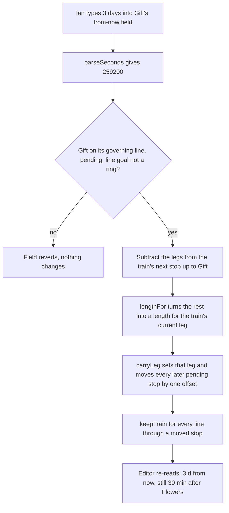

# Times That Stay - Plan

## Goal Capsule

- **Objective:** Ian can plan "the gift must be done within 3 days, and assembly takes 30 minutes after the flowers are finished" on one project line, read both times back later without moving anything, and change the deadline without losing the 30 minutes.
- **Means:** a goal drag carries the stops ahead with it instead of scaling them (KTD1), and the long-press editor shows and takes a stop's two times (KTD2, KTD3).
- **Authority:** the Product Contract's Key Decisions and Requirements win on behavior. KTDs win on mechanism. `docs/superpowers/specs/2026-10-31-tracks-design.md` and later specs hold wherever this plan is silent; U5 rewrites the spec text this plan replaces.
- **Execution profile:** one pull request from `main` (a8e3ec2), built on branch `feat/times-that-stay` in the worktree `C:\Users\alann\Code\chronologic-times`. Model first and test-first (U1 to U3), then the editor (U4), then docs (U5).
- **Stop conditions:** stop and report if carrying the stops ahead breaks the train-never-moves rule (`keepTrain` in `src/model/relocate.ts`) in a way a test cannot pin, or if the Shift drag from PR #10 can no longer keep its time.
- **Who finishes:** the executing agent builds, verifies, and opens the PR. Ian may let Claude merge.

---

## Product Contract

### Summary

Dragging a project's goal now moves the goal and every pending stop ahead of the train by the same offset. Only the leg the train is on changes, so later steps keep their planned length. A long press on a pending stop opens the editor with two time fields. One shows the leg into the stop, as "30 min after Flowers". The other shows how long until the train gets there, as "3 d from now". Typing into either sets that time exactly, and stops after it move along without changing their legs.

### Problem Frame

A leg's planned time is the length of its route on the plane. The plane has no other record of time. Ian's plan has two kinds of time: a deadline three days out and a 30-minute last step. Three rules on `main` fight that plan. A new goal starts 30 days out, and dragging it in scales every stop ahead of the train, so a 30-minute leg set first gets rescaled. The time chip shows only while a finger holds a stop, and only the leg into it, so the last leg can be read only by dragging the goal, which rescales it. At a zoom where 3 days fits the screen, 30 minutes is about 8 px and a medium circle is not drawn, so the short leg cannot be set by hand.

### Key Decisions

- **A goal drag moves the deadline, it does not stretch the work.** (session-settled: user-approved — chosen over proportional scaling about the train, and over "hand-set legs hold, the rest scale": scaling silently changed a 30-minute last step when the deadline moved, and one carry rule is easy to predict.) Governs R1, R2.
- **Times are read in the long-press editor.** (session-settled: user-approved — chosen over the drag-only time chip: reading a time must not need the gesture that changes it.) Governs R4, R5.
- **Times can be typed.** (session-settled: user-approved — chosen over dragging only: a 30-minute leg is about 8 px at a 3-day zoom, and one press plus a few words meets the friction rule in `design/flow-conditions.md`.) Governs R6, R7, R8.
- **The levels rule stays.** (session-settled: user-approved — chosen over never hiding short-leg stops: reading and typing times in the editor remove the need to see the short leg at far zoom.) Governs R11.

### Requirements

**Goal drag**

- R1. Dragging a project goal moves every pending stop strictly ahead of the train by the same offset as the goal, measured from where the drag began. Only the leg the train is on changes length.
- R2. A train waiting at a stop keeps that stop where it is. The leg after it is the one that changes.
- R3. Shift held during a goal drag still keeps the line's time, as PR #10 built it: the stops ahead stay where they were picked up and the goal slides to keep its leg.

**Reading times**

- R4. A long press on a pending stop on a project line opens the editor with the leg into the stop, written as "<time> after <previous stop's title>", or "after the start" for the first leg. An untitled previous stop reads "after the last stop".
- R5. The same editor shows how long from now until the stop's train arrives, written as "<time> from now". A stop the train is waiting at reads "now".

**Typing times**

- R6. Typing a duration into the leg field and pressing Return (or leaving the field) sets that leg to exactly that length. Every pending stop after it on the same line moves by one offset, so no other leg on that line changes.
- R7. Typing a duration into the from-now field makes the stop arrive that long from now by changing only the leg the train is on. The stops from there on move by one offset, so the legs between the train's next stop and this one keep their lengths.
- R8. Durations are written the way the chip writes them and a person would say them: "30 min", "3 days", "2 h 15 min", "1d 4h", "90m", "1.5 h". A bare number is minutes. Text that does not parse, or a duration of zero, changes nothing and the field shows the time it had.
- R9. A from-now time earlier than the train can reach the stop lands at the earliest reachable time, and the field shows the time that resulted.
- R10. A typed time is one undo step.

**Unchanged**

- R11. Which stops are drawn at each zoom (`src/plane/level.ts`) does not change.
- R12. A ring on the life line, and any line whose goal is a ring, shows its times but does not take typed ones. The fields are read-only there.

### Acceptance Examples

- AE1. **Covers R1, R6.** Given a line with the train rolling toward Flowers and Gift as the goal, and Gift's leg typed as "30 min", when Ian drags Gift three days further out, then Gift's leg still reads "30 min after Flowers" and Flowers' leg is three days longer.
- AE2. **Covers R7.** Given the same line, when Ian types "3 days" into Gift's from-now field, then Gift reads "3 d from now", Gift's leg still reads "30 min after Flowers", and Flowers reads about "2 d 23 h from now".
- AE3. **Covers R2.** Given the train waiting at Flowers, when Ian drags Gift, then Flowers stays put and the Flowers-to-Gift leg is the one that changes.
- AE4. **Covers R8.** Given the leg field reads "30 min", when Ian types "soon" and presses Return, then nothing on the plane moves and the field reads "30 min" again.

### Scope Boundaries

- Not in scope: the default 30-day goal distance for a new line. Typing "3 days" into the goal's from-now field replaces the drag that distance forced.
- Not in scope: times on done stops, the day's-end square, or stops no project train still has to reach. Their legs are history or have no train of their own.
- Not in scope: re-sorting a day line's stops into arrival order after a carry. The goal drag on `main` does not re-sort either (see Risks).

---

## Planning Contract

### Key Technical Decisions

- KTD1. **Carry by translation from the drag's start.** `moveGoal` computes `offset = (x, y) − from.goal` (or the goal's current point without a snapshot), and each carried stop goes to its `from.ahead` point plus that offset. Translating both ends of a leg keeps its 45-degree route, so its length is exactly unchanged. Working from the snapshot keeps the result independent of the finger's path, as the scaling did. With `stretch: false` the offset for carried stops is zero, which is PR #10's behavior today. The carried set is the pending stops after the train's point, decided once when the drag starts: from `train.leg` when the train is rolling, from `train.leg + 1` when it waits. With a `from` snapshot, `moveGoal` carries exactly the pending ids in `from.ahead`, and `projectDrag` in `src/ui/App.tsx` builds `ahead` by that rule. Re-deriving the set on each move would make the drag path-dependent: a carry that pulls the next stop closer than the train's covered seconds makes the train wait there, and a live rule would then drop that stop from the set. Only a call without a snapshot uses the live train. (session-settled: user-approved — chosen over proportional scaling about the train: scaling rescaled later legs when only the deadline moved.) Governs R1, R2, R3.
- KTD2. **The governing line decides which line a time belongs to.** A stop shared by several lines takes its times from `governingLine` in `src/model/arrive.ts`, the line whose train reaches it first. This is the line `slideTo` already uses for the week window, so both features agree on which line a stop's time comes from. The leg reads `legSeconds(trackRoute(...), index)`, and from-now reads `timeLeft` on that line. (session-settled: user-approved — chosen over the drag-only time chip.) Governs R4, R5.
- KTD3. **One model primitive sets a leg's length and carries what follows.** A new `carryLeg(world, trackId, legIndex, seconds, now)` in `src/model/arrive.ts` finds the stop's new point and moves every pending stop after it by the same offset. It works on the line it is given, never on the stop's own governing line, so the body of `legOf` is factored into `legOn(world, track, k, now)` and `legOf` calls it after `governingLine`. A shorter leg places the stop back along its own route. A longer leg runs it on along the leg's own last direction: `carryLeg` treats the leg as a goal leg, with its walk being `routeThrough([prev, stop])` rather than the walk on to the next station, so the goal branch of `pointFor` extends it and the re-routed length grows by exactly the extra seconds. Then `keepTrain` runs for every line that lists a moved stop. The leg field calls it on the stop's own leg (R6). The from-now field turns the wanted arrival into a length for the train's current leg using the existing `lengthFor`, after subtracting the legs from the train's next stop to this one, and calls it on that leg (R7). When the train waits at stop k, its current leg for this purpose is leg k+1, and the legs subtracted run from k+2 to the target, so the stop the train sits at never moves (R2). The reducer exposes both as actions `setLeg` and `setArrival`, each taking `stopId`, `seconds` and `now`. (session-settled: user-approved — chosen over dragging only.) Governs R6, R7, R9.
- KTD4. **The parser sits next to the formatter.** `parseSeconds` lives in `src/plane/grid.ts` beside `formatSeconds`. It accepts the suffixes `formatSeconds` writes (y, mo, w, d, h, min, s) plus the long forms and common shorthands (`m`, `hr`, `hrs`, `day`, `days`, `week`, …), with whole or decimal numbers and any spacing. It returns null for anything else. A month is 30 days and a year is 365 days, as in the grid. Governs R8.
- KTD5. **Each commit is its own dispatch.** The editor calls `endTitleStep()` and then dispatches once per committed field, so the store records one step without `begin()`/`end()`. Governs R10.

### High-Level Technical Design

What a typed from-now time does, in order. This is directional, not a specification:

### Assumptions

- Both fields can be typed into for every pending stop after the train's point, including the goal, unless R12 applies. The goal's from-now field is the deadline Ian actually wants. A stop the train is waiting at shows its times as text: its leg is already run, and its from-now reads "now".
- A bare number means minutes, since minutes are the unit people most often type for a single step.
- A leg shorter than the seconds the train has already covered on it puts the train at the stop, waiting. The spec already allows this for a dragged stop ("You pulled the platform to the train").
- Moving shared stops re-routes the other lines through them. Their trains keep their places, the same as the goal drag on `main`.
- The editor is the third exception to "no numbers anywhere beyond the grid legend and the leg chip" (`docs/superpowers/specs/2026-11-01-day-line-design.md`). U5 records it.

### Sequencing

U1, U2 and U3 are model-only and come first, test-first. U4 needs U1 and U3. U5 last.

---

## Implementation Units

### U1. Parse a duration

- **Goal:** turn the text a person types into seconds (R8, KTD4).
- **Requirements:** R8.
- **Dependencies:** none.
- **Files:** `src/plane/grid.ts`, `src/plane/grid.test.ts`.
- **Approach:** a small tokenizer over number-unit pairs. Round-trips `formatSeconds` output.
- **Execution note:** test-first.
- **Test scenarios:**
  - "30 min", "30m", "30 minutes" and "30" each give 1800.
  - "3 days", "3d" and "3 d" give 259200. "2 h 15 min" and "2h15m" give 8100. "1.5 h" gives 5400. "1 w" gives 604800. "1 mo" gives 2592000.
  - For each of 1 s, 45 min, 2 h 15 min, 3 d 4 h and 2 w 3 d, `parseSeconds(formatSeconds(x))` gives x.
  - "", "soon", "3 parsecs", "-2 h" and "0" give null.
- **Verification:** `npx vitest run src/plane/grid.test.ts` passes.

### U2. A goal drag carries the stops ahead

- **Goal:** `moveGoal` translates the carried stops instead of scaling them (KTD1).
- **Requirements:** R1, R2, R3.
- **Dependencies:** none.
- **Files:** `src/model/reducer.ts` (`moveGoal`), `src/ui/App.tsx` (`projectDrag`, which builds the `from` snapshot), `src/model/reducer.test.ts` (the `moveGoal` describe at about line 152, and the trains-under-edit cases at about lines 515 and 526), `src/ui/App.test.tsx` (any goal-drag test that asserts scaled positions).
- **Approach:** replace the scale factor with an offset as KTD1 states. Keep `keep`, `from`, the life-line refusal and the touched-lines `keepTrain` loop as they are. Read `heldGoalAt` and the life-line release path in `src/ui/App.tsx` to confirm they still put the carried stops back correctly when Shift is held or a goal joins the life line.
- **Execution note:** test-first. Rewrite the existing scaling assertions to describe the carry, without weakening them.
- **Test scenarios:**
  - With the train rolling toward stop A and goal G after it, dragging G by (+5000, +2000) moves A by the same offset, and the A-to-G leg's `legSeconds` is unchanged to within 1e-6.
  - With the train waiting at A, dragging G leaves A where it was, and only the A-to-G leg changes.
  - A done stop ahead of the train, done elsewhere, stays put.
  - Moving G there and back with one `from` snapshot returns every stop to its start, so the result does not depend on the path.
  - With one `from` snapshot and a fixed `keep`, dragging G until A is closer than the train's covered seconds (so the train waits at A), then back to the start, returns every stop to its start point.
  - `stretch: false` leaves carried stops at their `from.ahead` points (PR #10's existing test at about line 199 still passes).
  - The train's leg and covered seconds (`trainState(...).leg` and `.seconds`) are the same before and after the drag, to within the `keep` value, as the existing `moveGoal` tests check. Its point on screen can move when the leg's diagonal changes, and the spec allows that.
  - A ring goal still returns the same world.
- **Verification:** `npx vitest run src/model/reducer.test.ts src/ui/App.test.tsx` passes.

### U3. Set a leg, set an arrival

- **Goal:** the model can set one leg exactly, or one stop's arrival, and carry what follows (KTD3).
- **Requirements:** R6, R7, R9, R12.
- **Dependencies:** none (U1 is not needed by the model).
- **Files:** `src/model/arrive.ts`, `src/model/arrive.test.ts`, `src/model/reducer.ts` (new `setLeg` and `setArrival` actions in `Action`, cases delegating to `arrive.ts`), `src/model/reducer.test.ts`.
- **Approach:** add `carryLeg`, and a small `timesOf(world, stopId, now)` that returns the governing line, the leg seconds, the after-label, the from-now seconds, and whether the stop takes typed times. The after-label is the previous stop's title, "the start" for the first leg, or "the last stop" when the previous stop is untitled (R4). A stop takes typed times when it is pending, after the train's point (not the stop the train waits at), not a ring, and its line's goal is not a ring (R12). U4 reads that same helper, so the editor and the model agree. Factor `legOf` into `legOn` as KTD3 says, and reuse `lengthFor` and the goal branch of `pointFor`. Do not duplicate them.
- **Execution note:** test-first.
- **Test scenarios:**
  - On origin → Flowers → Gift, with the train rolling toward Flowers, `setLeg` on Gift with 1800 makes Gift's leg 1800 to within 1 s. Flowers does not move.
  - `setLeg` on Flowers with twice its leg makes Flowers' leg double, moves Gift by the same offset as Flowers, and leaves Gift's leg unchanged.
  - `setLeg` shorter than the original places the stop back along its own route. The route through it keeps the same bends.
  - `setArrival` on Gift with 259200 makes `timeLeft` for Gift 259200 to within 1 s, keeps Gift's leg the same, and moves Flowers.
  - `setArrival` earlier than reachable clamps: Gift arrives at the earliest time possible, which is the train's current leg at the seconds already covered plus the later legs.
  - With the train waiting at Flowers, `setArrival` on Gift leaves Flowers where it is and changes only the Flowers-to-Gift leg. `timesOf` on Flowers reports it as not taking typed times.
  - `setLeg` on a non-goal stop longer than its leg lands the stop on its own leg's line, not past the next station, and its leg measures the typed seconds to within 1 s.
  - `timesOf` gives "the last stop" as the after-label when the previous stop's title is empty.
  - `setLeg` with 0, on a done stop, on a stop behind the train, on a ring, or on a stop of a line whose goal is a ring returns the same world.
  - A stop shared with a second line: the second line re-routes and its train's `at` is unchanged.
  - A stop placed in the week window: after `setArrival` on a later stop of its line, its block end (`endOf`) still equals its arrival.
- **Verification:** `npx vitest run src/model/arrive.test.ts src/model/reducer.test.ts` passes.

### U4. The editor shows and takes times

- **Goal:** a long press shows a pending stop's two times, and Return or blur in either field commits a typed one (R4 to R10, R12).
- **Requirements:** R4, R5, R6, R7, R8, R9, R10, R12.
- **Dependencies:** U1, U3.
- **Files:** `src/ui/StopEditor.tsx`, `src/ui/StopEditor.test.tsx`, `src/ui/App.tsx` (the `<StopEditor>` props at about line 1497), `src/ui/App.test.tsx`, `src/styles/ui.css`.
- **Approach:** `StopEditor` takes an optional `times` prop (leg seconds, the after-label, from-now seconds, editable) plus `onLeg` and `onArrival`. App builds `times` from `timesOf` and re-reads it from the world on each render, so the fields show the result after a commit. Each field is a text input showing `formatSeconds(Math.round(seconds))`, with a muted suffix label ("after Flowers", "from now"). Rounding matters because the geometry returns a hair under the typed value and the from-now value is re-read a few milliseconds later, so a bare `formatSeconds` would show "29 min 59 s" or "2 d 23 h". Leave `formatSeconds` and the drag chip as they are.
  - **Typing:** a focused field keeps its own draft, so the clock's re-renders never overwrite text being typed. It re-syncs from `times` when it is not focused, and right after a commit or Escape. On Return or blur the field commits only when its text differs from what it showed when focused, so tabbing through or tapping away moves nothing and adds no undo step. A commit runs `parseSeconds`. Null or zero reverts the field, and anything else dispatches once (KTD5). Return commits and keeps the editor open with focus in that field. Escape reverts that field only. Tab order is title, leg, from-now.
  - **Layout:** the two times sit on their own row of the pill, above the shape and size buttons, so the pill never pushes Delete off a phone screen. The after-label truncates with an ellipsis. Read-only fields render as text, not inputs. Follow the editor's existing ink-pill styling and its focus rule: the title field keeps first focus.
- **Test scenarios:**
  - Starting from a line where Gift's from-now was typed as "3 days" and its leg as "30 min", the editor on Gift shows "30 min" with "after Flowers" and "3 d" with "from now". The editor on Flowers shows "2 d 23 h" with "from now".
  - Re-reading 50 ms after typing "3 days" still shows "3 d", and a typed "30 min" leg still reads "30 min" after a carry.
  - The first stop's leg reads "after the start". An untitled previous stop gives "after the last stop".
  - A stop the train waits at shows its leg as text and "now" as text, with no inputs.
  - Tabbing through both fields without typing, then closing the editor, leaves the world and the undo stack unchanged.
  - Return in a time field commits and leaves the editor open.
  - Typing "45 min" into Gift's leg field and pressing Return dispatches `setLeg` with 2700, and the field then shows "45 min".
  - Typing "soon" and pressing Return dispatches nothing and the field shows the old time (AE4).
  - Typing "3 days" into Gift's from-now field, in App, makes Gift's leg still read "30 min" (AE2).
  - One `store.undo()` after a typed time puts the world back as it was before it (R10).
  - A ring's editor shows its times as text with no inputs (R12).
  - A done stop's editor and the day's-end editor show no times.
- **Verification:** `npx vitest run src/ui/StopEditor.test.tsx src/ui/App.test.tsx` passes, and a dev-server check shows the fields on a long press (see Verification Contract).

### U5. Docs

- **Goal:** the spec text says what the app now does.
- **Requirements:** R1, R4, R6.
- **Dependencies:** U2, U4.
- **Files:** `docs/superpowers/specs/2026-10-31-tracks-design.md` (the "goal pins the length" paragraph near line 90, the touch-grammar goal bullet near line 212, the open item near line 338), `docs/superpowers/specs/2026-11-01-day-line-design.md` (the "No numbers" line near line 63), `README.md` if it describes the goal drag.
- **Approach:** rewrite those sentences in place, with no strikethrough. Keep the house voice: plain, no jargon.
- **Test expectation:** none, docs only.
- **Verification:** `grep -n "scales everything" docs README.md` finds nothing that describes the current behavior.

---

## Verification Contract

| Check | Command | Proves |
| --- | --- | --- |
| Unit and app tests | `npm test` | every R with a test scenario; nothing else regressed (700 tests passed on `main` at a8e3ec2) |
| Type-check and build | `npm run build` | `tsc --noEmit` passes and the bundle builds |
| One file while iterating | `npx vitest run <file>` | the unit's own scenarios |
| Real browser | `npm run dev` in the worktree, then a long press on a stop at http://localhost:5173, at desktop width and at about 390 px wide | the fields render, take typing and commit on a real pointer, and the pill fits a phone width with Delete on screen. If the Chrome extension cannot connect, record that it did not run. |

Tests run in jsdom (`src/test-setup.ts` fills in `PointerEvent`). Use the existing App test helpers for long press and drag rather than new ones.

## Definition of Done

- Every unit's test scenarios exist and pass, and `npm test` and `npm run build` are green in `C:\Users\alann\Code\chronologic-times`.
- AE1 to AE4 each have a test that names them.
- The spec text in U5 matches the new behavior.
- No dead code from abandoned approaches is left in the diff. The main checkout's uncommitted work on `fix/life-line-drag-off` is untouched.

## Risks & Dependencies

- **The uncommitted `timeUntil` and "until" chip in the main checkout** (`src/model/train.ts`, `src/ui/LegTime.tsx` on `fix/life-line-drag-off`) belong to another session. They overlap with R5. This plan uses `timeLeft` on the governing line instead. Whoever lands second should fold `timeUntil` into `timesOf` or drop it.
- **PR #9** (`fix/life-line-drag-off`) is open and conflicts with `main` in `src/ui/Stop.tsx`. This plan does not touch `Stop.tsx`.
- **Day-line order.** A carry can change which of a day's stops arrives first across different projects. The day line keeps its old order until something re-sorts it, as it does after a goal drag on `main` today.
- **A stop done from another line, ahead of the train,** stays put during a carry, so the legs on either side of it change. R1 and R6 then hold only approximately on that line. This is rare and the goal drag on `main` has the same gap.
- **The governing line can change after a carry.** Moving a shared stop re-routes the other lines through it, so another train may now reach the target first and the from-now result can differ from what was typed. The editor re-reads and shows the time that resulted (R9).
- **Carrying many stops.** On a line with many pending stops, a long goal drag moves the whole cluster and leaves one long first leg. That is the intended meaning (the work slides later), but it looks different from the old stretch.

## Sources & Research

- `src/model/reducer.ts` `moveGoal`: the scaling about `T` and the `stretch: false` path from PR #10.
- `src/model/arrive.ts`: `governingLine`, `legOf`, `lengthFor`, `pointFor`, `slideTo` (the week window's "block end is arrival" machinery). U3 reuses these.
- `src/model/relocate.ts` `keepTrain`: the rule that an edit never moves the train.
- `src/plane/grid.ts` `formatSeconds` and `PARTS`: the unit suffixes the parser must accept.
- `src/plane/level.ts` `LEVELS`: a medium circle is drawn only at the 1-hour grid or finer. At a 3-day framing the grid is 6 hours and a 30-minute leg is 7.8 px, measured in this session.
